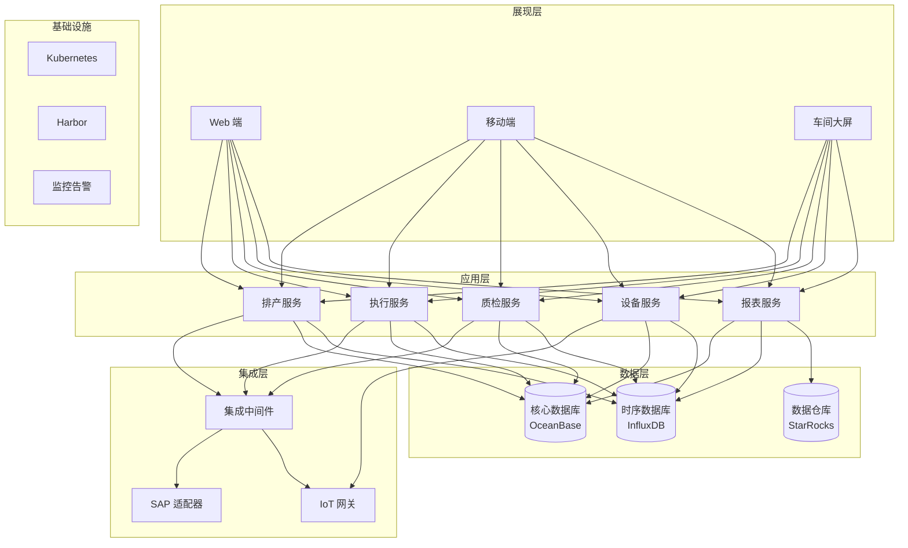
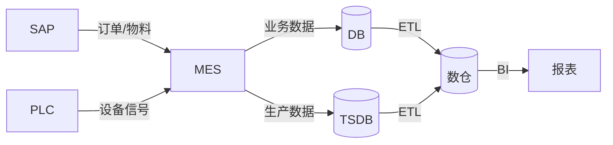

# /sa-architect — 总体方案 & 架构生成（Module 4）

> **端到端 7 模块流水线的第 4 站**
>
> /sa-intake → /sa-clarify → /sa-solution-map →【本命令】→ /sa-poc/impl/rfp → /sa-quote → /sa-archive

## 一句话

**输入方案定位，输出一份包含完整业务架构、技术架构、部署模式、集成关系的《总体方案》文档 + 自动跑三项校验**（痛点匹配 / 合规约束 / 可行性）。

## 输入

```bash
# 最常见：接 M3 输出
/sa-architect ./output/sa-pipeline/xxx/02-solution-map.md

# 显式指定部署模式
/sa-architect ./02-solution-map.md --deployment private

# 输出到自定义目录
/sa-architect ./02-solution-map.md --out ./output/sa-pipeline/xxx/03-architect/
```

## 内部两个子 Agent

### Agent 4-1：总体解决方案生成

**输入**：方案定位（M3 输出）

**输出结构**（8 章）：
1. **项目总体目标**（业务目标 + 交付目标）
2. **总体业务架构**（业务域 → 业务能力 → 业务流程）
3. **总体技术架构**（分层 + Mermaid 架构图）
4. **模块组成说明**（每个模块：职责 / 输入 / 输出 / 依赖）
5. **部署模式**（公有云 / 私有化 / 混合部署，硬件 / 软件形态）
6. **集成关系**（与客户现有系统对接方式）
7. **数据架构**（数据流 / 存储 / 主数据管理）
8. **安全架构**（认证 / 授权 / 审计 / 加密 / 合规）

### Agent 4-2：方案自动校验（三项）

调用 `skills/sa/sa-solution-validate` 跑：

#### 校验 1：痛点匹配（Coverage）
- 遍历 01-clarify-report.md 中所有痛点
- 检查每条痛点在方案中是否有响应的模块 / 能力
- 输出未响应清单

#### 校验 2：约束合规（Compliance）
- 遍历硬性合规约束（等保 / 国产化 / 数据不出境）
- 检查方案是否显式回应
- 输出违规清单

#### 校验 3：可行性（Feasibility）
- 识别明显不匹配的设计（如"3 个月内上线 + 5 个高工作量定制"）
- 检查资源估算与规模是否合理
- 输出风险清单

## Harness 卡点

- **架构生成后 gate**：AskUserQuestion 展示：
  ```
  【总体方案已生成】
    模块数：{n}
    集成点：{m}
    部署形态：{private/public/hybrid}
    合规回应度：{n}/{total}

  请选择：
  (1) 通过 → 跑三项校验
  (2) 修改架构 → 我编辑后按回车
  (3) 驳回 → 回 M3 重新定位
  ```

- **校验后 gate**：如果有 🔴 项：
  ```
  【方案校验完成】
    痛点匹配：✅ / 部分匹配（{n} 条未回应）
    合规约束：❌ 未回应"数据不出境"
    可行性：⚠️  3 月上线 + 高定制存在冲突

  请选择：
  (1) 修改方案 → 回本命令 `--refine`
  (2) 强制通过 → 记入 known-issues.md
  (3) 中止
  ```

## 输出目录

```
./output/sa-pipeline/{client}-{project}-{yyyymmdd}/
├── 03-overall-solution.md      ← 【本命令产出】总体方案主文档
├── 03-architecture.mmd         ← 【本命令产出】Mermaid 架构图源码
├── 03-business-arch.mmd        ← 业务架构图
├── 03-deployment-arch.mmd      ← 部署架构图
└── 03-solution-validate.md      ← 三项校验报告
```

## 输出格式（总体方案标准结构）

```markdown
# 总体方案：{{client}} - {{project}} v1.0

> 上游：02-solution-map.md
> 生成时间：{{yyyy-mm-dd hh:mm}}
> 部署模式：{{private / public / hybrid}}

## 1. 项目总体目标
### 1.1 业务目标（对齐客户痛点）
- 生产效率提升 15%（对齐痛点 P1）
- 缺陷率降低 30%（对齐痛点 P3）
- 月末对账时间从 3d → 0.5d（对齐痛点 P5）

### 1.2 交付目标
- 3 个月内完成部署上线
- POC 阶段 4 周
- 培训覆盖 200 名一线人员

## 2. 总体业务架构

```mermaid
flowchart TB
  subgraph 业务域[业务域]
    生产管理[生产管理]
    质量管理[质量管理]
    设备管理[设备管理]
    数据分析[数据分析]
  end

  subgraph 业务能力[业务能力]
    生产管理 --> 智能排产 & 工单管理 & 进度跟踪
    质量管理 --> 实时质检 & 缺陷分析
    设备管理 --> 设备接入 & OEE 统计
    数据分析 --> 实时看板 & 报表
  end
```

## 3. 总体技术架构



### 3.1 分层说明
| 层 | 组件 | 说明 |
|---|---|---|
| 展现层 | Web / Mobile / 大屏 | 客户端多端支持 |
| 应用层 | 微服务 6 个 | 按业务域拆分 |
| 集成层 | ESB + 适配器 | 对接客户 SAP / IoT |
| 数据层 | 关系库 + 时序库 + 数仓 | 分层存储 |
| 基础设施 | K8s + Harbor + 监控 | 国产化平台 |

## 4. 模块组成说明

### 4.1 排产服务（Planning）
- **职责**：接单 → 智能排产 → 下发工单
- **输入**：ERP 订单 + 产能约束
- **输出**：车间工单 + 时间表
- **关键算法**：约束求解 + 遗传算法
- **依赖**：设备服务（读产能）+ ERP 适配器

### 4.2 执行服务（Execution）
（同上格式）

... 其余模块

## 5. 部署模式
### 5.1 部署形态
- **模式**：私有化部署
- **位置**：客户 IDC（北京主 + 上海灾备）
- **软件形态**：容器化交付（Docker + K8s）
- **硬件建议**：
  - 应用节点：8 vCPU / 32 GB / 500 GB SSD × 6 台
  - 数据节点：16 vCPU / 128 GB / 4 TB SSD × 3 台
  - 大屏节点：4 vCPU / 16 GB × 2 台

### 5.2 高可用
- 应用：K8s 3 副本 + 自动重启
- 数据库：OceanBase 三副本 + 主从
- RPO ≤ 15 分钟，RTO ≤ 30 分钟

### 5.3 部署架构图
（放到 03-deployment-arch.mmd）

## 6. 集成关系

| 客户系统 | 集成方式 | 数据方向 | 频率 | 责任方 |
|---|---|---|---|---|
| SAP S/4HANA | REST + BADI | 双向 | 实时 + 定时 | 联合 |
| PLC/SCADA | OPC UA | 采集 | 实时 | 我方 |
| LDAP/AD | LDAP | 认证 | 实时 | 客户 |
| 短信平台 | HTTP API | 发送 | 事件驱动 | 客户 |

## 7. 数据架构
### 7.1 主数据管理
- 物料主数据：SAP 为源，同步到 MES
- 用户主数据：LDAP 为源

### 7.2 数据流


### 7.3 数据留存
| 数据类型 | 热存储 | 冷存储 | 备份 |
|---|---|---|---|
| 业务数据 | 1 年 | 5 年 | D+1 全量 |
| 设备时序 | 3 月 | 3 年 | D+1 增量 |
| 审计日志 | 6 月 | 3 年 | 加密备份 |

## 8. 安全架构

| 层次 | 措施 |
|---|---|
| 认证 | LDAP SSO + 密码策略 + MFA（管理员） |
| 授权 | RBAC 4 级 + 数据权限（车间 / 部门） |
| 传输 | TLS 1.3（内 + 外） |
| 存储 | 国密 SM4 加密敏感数据 |
| 审计 | 全动作审计日志，保留 ≥ 180 天 |
| 合规 | 等保三级 + 国产化 100% + 数据不出园区 |

## 9. 推荐下一步
- [ ] 认可总体方案 → `/sa-poc-impl-rfp ./03-overall-solution.md`
- [ ] 需调整架构 → 本命令 `--refine "把 ESB 换成 API 网关"`
- [ ] 校验有 🔴 项 → 修复后重跑

## 附：调用的 Skill
- sa-architect（架构分层规范 + Mermaid 规范）
- sa-solution-validate（三项校验）
```

## 校验报告标准结构（03-solution-validate.md）

```markdown
# 方案校验报告

## 总体结论
- ✅ 通过 / 🟡 有修改建议 / 🔴 需重写

## 1. 痛点匹配 [n]/[total]
| # | 痛点 | 是否响应 | 位置 | 建议 |
|---|---|---|---|---|
| P1 | 排产靠 Excel | ✅ | § 4.1 排产服务 | — |
| P2 | 质检数据不实时 | ✅ | § 4.3 质检服务 | — |
| P3 | 5000 台设备 | 🟡 | § 4.4 设备服务 | 补 5000 并发压测承诺 |

## 2. 合规约束 [n]/[total]
| # | 约束 | 是否回应 | 方案位置 | 建议 |
|---|---|---|---|---|
| L1 | 等保三级 | ✅ | § 8 安全架构 | — |
| L2 | 国产化 100% | ✅ | § 5 部署 | — |
| L3 | 数据不出境 | 🔴 未显式回应 | — | § 5 加"数据全部在客户 IDC" |

## 3. 可行性 [n] 项
| # | 冲突/风险 | 建议 |
|---|---|---|
| F1 | 3 月上线 + 3 个高定制 | 建议分二期，或延长 1 月 |

## 4. 推荐下一步
- [ ] 修复 🔴 后重跑
- [ ] 通过 → 进入 M5
```

## 与其他命令的边界

| 场景 | 用 |
|---|---|
| **方案定位 → 总体方案 + 架构 + 校验** | 本命令 |
| 生成 POC / 实施 / RFP 应答 | 下一步 M5 系列 |
| 需要一键跑完整 7 模块 | `/sa-pipeline` |
| 只做架构图 | 本命令产出 03-architecture.mmd |

## 反模式

- ❌ 架构只写文字不出 Mermaid —— 违规
- ❌ 部署模式没写硬件建议 —— 违规
- ❌ 安全架构缺合规映射 —— 违规
- ❌ 校验 🔴 项未修复就交付 —— 违规
- ❌ 集成关系没写"责任方" —— 会在实施阶段扯皮
