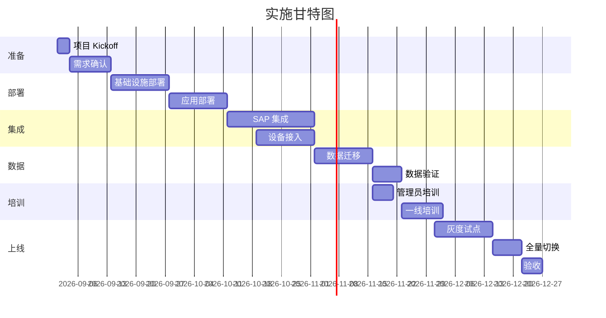

# /sa-impl — 实施方案（Module 5.2）

> **端到端 7 模块流水线的第 5.2 站（专项之二）**

## 一句话

**基于总体方案生成一份可交付客户的实施方案** —— 阶段 / 步骤 / 人员 / 切换策略 / 培训。

## 输入

```bash
/sa-impl ./output/sa-pipeline/xxx/03-overall-solution.md --duration 3
```

## 输出格式

```markdown
# 实施方案：{{client}} - {{project}}

> 上游：03-overall-solution.md
> 生成时间：{{yyyy-mm-dd hh:mm}}
> 实施周期：{{duration}} 个月

## 1. 实施总体目标
- 3 个月内完成 {{n}} 个模块的部署上线
- 平滑切换，不影响客户日常生产
- 培训覆盖率 100%

## 2. 实施阶段划分



### 2.1 阶段详情

#### 阶段 1：准备（W1-W2）
- **目标**：项目正式启动，需求最终锁定
- **关键动作**：
  - Kickoff 会议（双方负责人参加）
  - 需求最终确认（客户签字）
  - 项目章程 / 沟通机制 / 变更控制 建立

#### 阶段 2：部署（W3-W6）
- **目标**：软件全部部署到客户环境
- **关键动作**：
  - K8s / 数据库集群部署
  - 应用服务部署
  - 监控 / 日志 / 备份 就位

#### 阶段 3：集成（W5-W10）
- **目标**：与客户现有系统全部连通
- **关键动作**：
  - SAP 双向接口开发 + 联调
  - PLC/SCADA 设备接入
  - LDAP SSO 对接
  - 短信 / 邮件通道对接

#### 阶段 4：数据迁移（W9-W11）
- **目标**：老系统数据完整迁移
- **关键动作**：
  - 数据清洗 / 规则整理
  - 全量迁移 + 增量同步
  - 数据比对 / 校验

#### 阶段 5：培训（W11-W13）
- **目标**：管理员 + 一线人员全部掌握新系统
- **关键动作**：
  - 管理员深度培训（5 天）
  - 一线培训（工作坊 + 视频）
  - 操作手册 / FAQ

#### 阶段 6：上线（W13-W16）
- **目标**：平滑切换，客户签字验收
- **关键动作**：
  - 试点车间灰度（1-2 周）
  - 全量切换
  - 稳定期观察（1 周）
  - 验收会议 + 签字

## 3. 人员角色

### 3.1 双方职责矩阵（RACI）

| 活动 | 客户方 | 我方 |
|---|---|---|
| 需求确认 | 业务负责人（R）+ CIO（A） | 售前（C）+ 项目经理（C） |
| 硬件采购 | IT（R）+ 采购（A） | 售前（C） |
| 软件部署 | IT（S） | 部署工程师（R）+ 架构师（A） |
| SAP 集成 | SAP 团队（R）+ IT（A） | 集成工程师（R）+ 架构师（C） |
| 数据迁移 | 业务（S） | 数据工程师（R）+ 项目经理（A） |
| 培训 | HR / 业务负责人（C） | 培训师（R） |
| 上线切换 | IT（S）+ 业务（S） | 项目经理（R）+ 架构师（A） |
| 验收 | CIO / 业务负责人（A） | 项目经理（R） |

**说明**：R=Responsible、A=Accountable、C=Consulted、S=Supporting

### 3.2 我方团队配置
| 角色 | 人数 | 参与阶段 | 常驻/远程 |
|---|---|---|---|
| 项目经理 | 1 | 全阶段 | 部分驻场 |
| 架构师 | 1 | 部署 / 集成 | 远程 + 关键节点驻场 |
| 部署工程师 | 1-2 | 部署 / 数据迁移 | 驻场 |
| 集成工程师 | 1 | 集成 | 驻场 |
| 培训师 | 1 | 培训阶段 | 驻场 |
| 售后支持 | 1 | 上线后 | 远程 |

### 3.3 客户方期望配置
| 角色 | 期望投入 | 备注 |
|---|---|---|
| 项目 Sponsor | 5% | 关键会议 + 决策 |
| IT 负责人 | 30% | 全阶段 |
| 业务负责人 | 20% | 需求 / 培训 / 验收 |
| SAP 团队 | 30% | 集成阶段全投入 |
| 车间试点主管 | 50% | 灰度期 |

## 4. 上线切换策略

### 4.1 切换方式：并行 + 灰度
1. **并行期**（2 周）：老系统 + 新系统同时跑，业务方双录入
2. **试点车间**（2 周）：1 个车间只用新系统
3. **全量切换**（1 周）：全车间新系统
4. **稳定期**（1 周）：老系统只读，观察新系统

### 4.2 回滚计划
| 触发条件 | 回滚动作 | 决策人 |
|---|---|---|
| 新系统 P0 故障 > 4 小时 | 立即切回老系统 | CIO + 项目经理 |
| 数据不一致率 > 1% | 停止推进，回并行 | 项目经理 |
| 业务方投诉 > 10 次/天 | 排查后决策 | 业务负责人 |

### 4.3 数据回退
- 新系统数据保留但停写
- 老系统数据同步机制保留 1 个月
- 切回后 5 个工作日内补录

## 5. 培训计划

### 5.1 管理员培训（5 天）
| 天 | 内容 | 时长 | 讲师 |
|---|---|---|---|
| D1 | 系统概览 + 架构 + 部署 | 6h | 架构师 |
| D2 | 用户权限管理 + 数据管理 | 6h | 部署工程师 |
| D3 | 集成配置（SAP / LDAP） | 6h | 集成工程师 |
| D4 | 监控 / 告警 / 备份 | 6h | 部署工程师 |
| D5 | 故障排查 + Q&A | 6h | 架构师 |

### 5.2 一线培训
- **形式**：小组工作坊 + 视频 + 操作手册
- **对象**：200 名一线操作员
- **时长**：3 小时 / 人（1.5h 讲解 + 1.5h 实操）
- **考核**：每人完成 3 个典型操作场景演练

### 5.3 培训材料
- [ ] 管理员手册（PDF 100+ 页）
- [ ] 一线操作手册（PDF 30 页）
- [ ] 培训视频（10 个，每个 5-10 分钟）
- [ ] FAQ 文档（20-30 条）
- [ ] Cheat Sheet（一页纸速查）

## 6. 沟通机制
- **每日站会**（部署 / 集成期）：15 分钟同步进度
- **每周例会**：项目经理主持，双方核心成员参加
- **月度汇报**：CIO / Sponsor 参加，看整体进度和风险
- **紧急联络**：24 小时值班电话

## 7. 变更控制
- **变更提出**：书面变更申请单
- **影响评估**：项目经理 24 小时内出评估
- **决策**：小变更（≤ 3 人天）项目经理决定；大变更需双方 Sponsor 签字
- **入库**：所有变更进入 CHANGELOG，影响归档版本号

## 8. 实施风险

| # | 风险 | 概率 | 影响 | 缓解 |
|---|---|---|---|---|
| I1 | 客户 IT 人力不足 | 高 | 中 | 我方驻场支持 + 培训 |
| I2 | 数据迁移出错 | 中 | 高 | 双跑 + 分批 + 每批校验 |
| I3 | SAP 团队配合度低 | 中 | 高 | 提前建立联系 + Sponsor 施压 |
| I4 | 一线抵触 | 中 | 中 | 前期访谈 + 领导支持 + 激励 |
| I5 | 上线延期 | 中 | 高 | 每周同步 + 提前预警 + 应急方案 |

## 9. 附：调用的 Skill
- sa-impl-plan（实施阶段模板 + RACI 模板）
```

## 与其他命令的边界

| 场景 | 用 |
|---|---|
| **总体方案 → 实施方案** | 本命令 |
| POC 测试方案 | `/sa-poc` |
| RFP 应答 | `/sa-rfp` |
| 需要一键跑完整 7 模块 | `/sa-pipeline` |

## 反模式

- ❌ 阶段划分不出 Mermaid 甘特图 —— 违规
- ❌ 人员角色不写 RACI —— 违规
- ❌ 上线切换没写回滚方案 —— 违规
- ❌ 培训只有内容没有考核 —— 违规
- ❌ 沟通机制不写紧急联络 —— 生产事故时会乱
