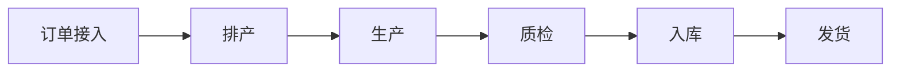

# /sa-solution-map — 方案拆解与定位（Module 3）

> **端到端 7 模块流水线的第 3 站**
>
> /sa-intake → /sa-clarify →【本命令】→ /sa-architect → /sa-poc/impl/rfp → /sa-quote → /sa-archive

## 一句话

**把客户痛点映射到我方产品能力，输出一份「能不能做 / 怎么做 / 有什么风险 / 与竞品对比如何」的方案定位文档**。

## 输入

```bash
# 最常见：接 M2 输出
/sa-solution-map ./output/sa-pipeline/xxx/01-clarify-report.md

# 指定我方产品线（如果有多条产品线）
/sa-solution-map ./01-clarify-report.md --our-product "智能制造 SaaS"
```

## 内部三个子 Agent

### Agent 3-1：业务-能力映射

**输入**：调研痛点报告

**输出**：
1. **客户业务流程梳理**（Mermaid + 步骤表）
2. **痛点-能力映射对照表**（每条痛点 → 我方能力）
3. **覆盖度评估**：
   - ✅ 完全覆盖（标品）
   - 🟡 部分覆盖（需配置 / 少量开发）
   - 🔴 不支持（需定制 / 需第三方）
4. **必须第三方集成点**（如客户现有 ERP / 短信平台）
5. **定制开发点**（工作量初估 —— 仅标"低/中/高"，不出人天）

### Agent 3-2：竞争分析

**输出**：
- **识别客户可能对比的竞品**（同类型产品 + 通用替代 + 自建选项）
- **我方 vs 竞品对照**（能力 / 价格 / 交付 / 品牌 / 生态）
- **我方优势点**（在此单里能打的差异化）
- **我方劣势点 & 规避策略**（劣势不隐瞒，但怎么话术转移）

### Agent 3-3：项目风险 & 依赖识别

**5 类风险**（每类至少 1 条）：
1. **外部依赖**：第三方 API / 客户系统集成 / 第三方合规认证
2. **集成风险**：客户现有系统数据模型冲突 / 接口不开放
3. **定制开发风险**：定制多少 / 定制周期 / 后续升级怎么办
4. **合规风险**：等保 / 国产化 / 数据不出境 是否有确定路径
5. **实施风险**：客户 IT 参与度 / 培训 / 变更管理

## 输出格式

```markdown
# 方案拆解与定位：{{client}} - {{project}}

> 上游：01-clarify-report.md
> 生成时间：{{yyyy-mm-dd hh:mm}}
> 我方产品：{{our-product}}

## 1. 客户业务流程梳理


### 1.1 关键步骤
| # | 步骤 | 负责 | 现有系统 | 主要痛点 |
|---|---|---|---|---|
| 1 | 订单接入 | 销售 | ERP | 手工录入 |
| 2 | 排产 | 车间主任 | Excel | 慢/易错 |
| ... | ... | ... | ... | ... |

## 2. 痛点-能力映射对照表
| # | 客户痛点 | 我方能力模块 | 覆盖度 | 说明 |
|---|---|---|---|---|
| P1 | 排产靠 Excel | 智能排产模块 | ✅ 完全覆盖 | 标品支持约束求解 |
| P2 | 质检数据不实时 | IoT 采集 + 实时看板 | 🟡 部分覆盖 | 需对接 PLC，1 次对接开发 |
| P3 | 5000 台设备接入 | 设备管理平台 | 🟡 部分覆盖 | 需扩展协议解析器（3-5 种） |
| P4 | 与 SAP 深度对接 | 集成中间件 | 🔴 不支持 | 需定制开发适配 SAP 特殊接口 |

## 3. 覆盖度汇总
### 3.1 完全覆盖能力
- 智能排产
- 生产工单管理
- 移动端应用

### 3.2 部分覆盖能力（需配置或少量开发）
- IoT 数据采集（工作量：中）
- 5000 台设备接入（工作量：中）

### 3.3 不支持能力（需定制或第三方）
- SAP 特殊接口对接（定制，工作量：高）
- 客户历史数据迁移（一次性服务，工作量：中）

### 3.4 必须第三方集成点
| 集成对象 | 现状 | 集成方式 | 责任方 |
|---|---|---|---|
| SAP S/4HANA | 客户已用 | REST API + BADI | 联合 |
| 客户短信网关 | 现有 | HTTP API | 客户 |
| 客户 SSO（LDAP） | 现有 | LDAP 协议 | 客户 |

### 3.5 定制开发范围（🔒 人工审阅）
| # | 定制项 | 工作量估计 | 优先级 | 备注 |
|---|---|---|---|---|
| D1 | SAP 特殊接口 | 高 | P0 | 客户强要求 |
| D2 | 排产算法调整 | 中 | P0 | 客户业务特殊 |
| D3 | 报表模板定制 | 低 | P1 | 可延后 |

## 4. 竞争分析
### 4.1 客户可能对比的竞品
| # | 竞品 | 类型 | 覆盖度 | 客户熟悉度 |
|---|---|---|---|---|
| 1 | 用友 CraftSmart | 商用同类 | 类似 | 高 |
| 2 | 西门子 Opcenter | 高端 | 更全 | 中 |
| 3 | 客户自研 | DIY | 未知 | 低 |

### 4.2 我方 vs 竞品对照
| 维度 | 我方 | 用友 | 西门子 |
|---|---|---|---|
| 排产算法 | ✅ 强 | 一般 | 强 |
| 国产化 | ✅ 全国产 | 部分 | 弱 |
| 价格 | 中 | 中 | 高 |
| 交付周期 | 3 月 | 3 月 | 6 月 |
| 制造行业经验 | 中 | 强 | 强 |
| 后续演进 | 迭代快 | 一般 | 慢 |

### 4.3 我方优势点（重点在方案中突出）
- 🎯 **国产化率 100%**（对齐客户信创要求）
- 🎯 **智能排产算法**（较竞品有实测数据支持）
- 🎯 **快速交付能力**（3 月上线可承诺）

### 4.4 我方劣势点 & 规避
| 劣势 | 规避策略 |
|---|---|
| 制造行业案例数量少于用友 | 突出案例的深度而非数量；强调 POC 验证 |
| 品牌知名度弱于西门子 | 强调 CIO 决策的性价比与政策对齐 |

## 5. 项目风险 & 依赖
### 5.1 外部依赖
| # | 依赖 | 影响 | 缓解 |
|---|---|---|---|
| E1 | 客户 SAP 接口开放 | 高 | 早期约定接口范围 |
| E2 | 客户 IT 提供 SSO | 中 | 备用本地账号 |

### 5.2 集成风险
| # | 风险 | 概率 | 影响 | 缓解 |
|---|---|---|---|---|
| I1 | SAP 数据模型不兼容 | 中 | 高 | 中间件层适配 |
| I2 | 老 MES 数据迁移 | 高 | 中 | 双跑 + 灰度 |

### 5.3 定制开发风险
| # | 风险 | 缓解 |
|---|---|---|
| D1 | 定制过多影响后续升级 | 定制通过扩展点实现，不改核心 |
| D2 | 客户中途改需求 | 严格变更控制 + 双方签字 |

### 5.4 合规风险
| # | 风险 | 缓解 |
|---|---|---|
| L1 | 国产化率待客户确认名单 | M2 已列待确认项，POC 前必须确认 |
| L2 | 数据不出园区 | 私有化部署 + 数据加密 |

### 5.5 实施风险
| # | 风险 | 缓解 |
|---|---|---|
| R1 | 客户 IT 人手不足 | 派驻现场支持 + 培训计划 |
| R2 | 车间人员抵触新系统 | 前期访谈 + 试点车间 |

## 6. 方案定位（一句话）
**"针对远大制造老 MES 替换项目，以我方国产化 MES 标品为核心，配套 SAP 深度对接的定制模块，3 个月完成部署上线，通过智能排产和实时质检两个差异化能力构建对用友、西门子的竞争壁垒。"**

## 7. 推荐下一步
- [ ] 认可方案定位 → `/sa-architect ./02-solution-map.md`
- [ ] 需调整能力匹配 → 本命令 `--refine "P4 由部分覆盖 → 不支持，需定制"`
- [ ] 需要更多竞品数据 → 补充后再跑

## 附：调用的 Skill
- sa-capability-mapping（能力映射规则）
- sa-competitive-analysis（竞品对标）
- sa-clarify（复用行业模板）
```

## Harness 卡点

- **能力映射完成后**：AskUserQuestion 展示覆盖度汇总，确认后进入竞争分析
- **定制范围锁定 gate**：定制清单强制要求人工审阅：
  ```
  【定制范围确认】识别到 {n} 项需定制开发（工作量 X 高 / Y 中 / Z 低）
  这些将影响 M5 POC / 实施 / 报价，请审阅：
    - D1 SAP 特殊接口（高）
    - D2 排产算法调整（中）
    - D3 报表模板定制（低）

  是否锁定定制范围？(y / n / edit)
  ```

## 与其他命令的边界

| 场景 | 用 |
|---|---|
| **痛点报告 → 方案定位** | 本命令 |
| 生成总体方案 & 架构 | 下一步 `/sa-architect` |
| 需要一键跑完整 7 模块 | `/sa-pipeline` |
| 只做竞品对比 | 本命令（结果里有 § 4） |

## 反模式

- ❌ 覆盖度只写"支持"不写"完全/部分/不支持" —— 违规
- ❌ 定制清单没标工作量 —— 违规
- ❌ 竞争分析只夸自己不写劣势 —— 违规，会给售后埋雷
- ❌ 项目风险 5 类少写 —— 违规，POC 阶段会踩坑
- ❌ 方案定位不是一句话 —— 违规，客户听不进去
