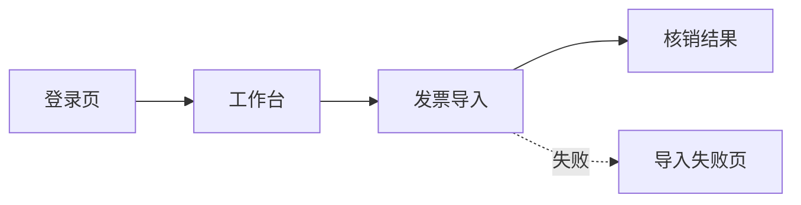
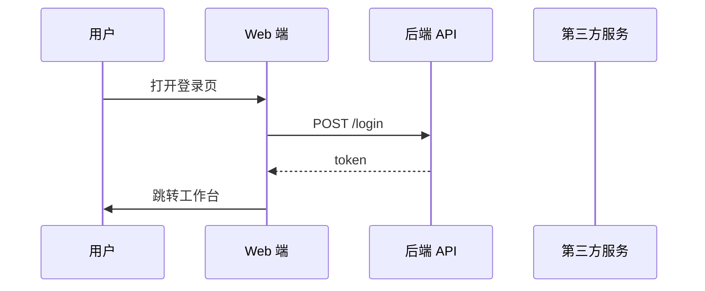

# /pm-prototype — 原型辅助生成 Agent（Module 4）

> **端到端 6 模块流水线的第 3 站**
>
> /pm-clarify → /pm-solution →【本命令】→ /prd → /pm-tech-spec → /pm-archive

## 一句话

**把业务方案变成产品经理可以直接拿去与设计师/研发对齐的原型底稿**：页面清单、组件与跳转逻辑、流程图、以及可导入 Figma/Axure/Penpot 的结构化 JSON。

## 关于"AI 不能直接输出 Figma 文件"的声明

本命令**不产出**可交互的 Figma / Sketch / Penpot 源文件。**产出**：

1. **原型描述文档**（Markdown）：每个页面的用途、组件、字段、按钮、弹窗、跳转
2. **Mermaid 流程图**（`.mmd`）：主流程 + 异常流程可视化
3. **结构化原型 JSON**（`.json`）：符合通用 Schema，可被前端插件（如 [Figma to Code]、Axure Import、Penpot API）读取
4. **ASCII 线框图**（`.md` 内嵌）：4 状态（默认 / 空态 / 加载 / 错误）

PM 拿到这份底稿后，做二次微调（微调设计细节、动效、视觉），即可交付。

## 输入

```bash
# 默认接第 3 站输出
/pm-prototype ./output/pm-pipeline/{topic}-{date}/02-business-solution.md

# 显式指定保真度
/pm-prototype 02-business-solution.md --fidelity low     # ASCII 线框图 + JSON
/pm-prototype 02-business-solution.md --fidelity mid     # 加 Mermaid + 组件规格

# 显式指定平台
/pm-prototype 02-business-solution.md --platform web
/pm-prototype 02-business-solution.md --platform mobile  # 加移动端手势与竖屏
```

## 内部两个子 Agent

### Agent 4-1：页面 & 交互生成

**输入**：业务方案（含功能清单与主流程）

**输出**：
- **页面清单**：page-id / 名称 / 用途 / 用户角色
- **每页详情**：组件树、输入项、按钮、弹窗、状态（默认/空/加载/错误）、跳转
- **Mermaid 流程图**：主流程 + 异常流程
- **结构化原型 JSON**（详见下方 Schema）

### Agent 4-2：原型逻辑校验（自动执行）

**检查项**（Skill：pm-prototype-design 提供规则库）：
- ✅ **跳转闭环**：每个 goto 目标页面必须在清单中
- ✅ **异常场景**：每个"接口调用" / "外部依赖"必须有异常态设计
- ✅ **必填项**：每个表单必须标出必填 / 可选
- ✅ **状态覆盖**：每个动态区域必须有 4 状态设计
- ✅ **角色权限一致性**：与业务方案的权限矩阵一致
- ✅ **返回路径**：每个非首页都有明确返回路径
- ✅ **无孤岛页面**：每个页面都有进入路径

## 输出目录结构

```
./output/pm-pipeline/{topic}-{date}/
  03-prototype/
    ├── 03-prototype-desc.md    ← 原型描述文档（主文档）
    ├── 03-prototype.json       ← 结构化 JSON（可导入工具）
    ├── 03-flow.mmd              ← Mermaid 流程图源码
    ├── 03-flow-exception.mmd    ← 异常流程图源码
    └── 03-validate.md           ← 逻辑校验报告
```

## 输出格式（原型描述文档标准结构）

```markdown
# 原型底稿：{{topic}}

> 上游：02-business-solution.md
> 生成时间：{{yyyy-mm-dd hh:mm}}
> 保真度：{{low / mid}}
> 平台：{{web / mobile / desktop}}

## 1. 页面地图


## 2. 页面清单
| Page ID | 名称 | 用途 | 用户角色 | 入口 |
|---|---|---|---|---|
| P1 | 登录页 | 身份认证 | 全部 | 首次访问 |
| P2 | 工作台 | 功能入口 | 财务专员/主管 | P1 → P2 |
| ... | ... | ... | ... | ... |

## 3. 每页详情

### P1 — 登录页
- **用途**：身份认证 + 记住登录
- **组件树**：
  ```
  Container
    ├── Logo
    ├── Form
    │   ├── Input[username]（必填，8-32 字符）
    │   ├── Input[password]（必填，密码强度 ≥ 中）
    │   └── Checkbox[remember_me]
    ├── Button[submit]（主按钮）
    ├── Link[forget_password]
    └── Link[sso]
  ```
- **4 状态设计**：
  - 默认：空表单
  - 加载：Button 转 loading
  - 错误：字段红字 + 上方 Alert
  - 空态：N/A（登录页无空态）
- **跳转规则**：
  - submit 成功 → P2 工作台
  - forget_password → P1F 忘记密码页
  - sso → 外部 IdP
- **ASCII 线框图**：
```
┌─────────────────────────┐
│         [Logo]          │
│                         │
│  用户名 ┌──────────┐    │
│         └──────────┘    │
│  密码   ┌──────────┐    │
│         └──────────┘    │
│  ☐ 记住我               │
│                         │
│    ┌──────────────┐     │
│    │    登录      │     │
│    └──────────────┘     │
│                         │
│  忘记密码?    SSO 登录  │
└─────────────────────────┘
```

### P2 — 工作台
（同上格式）

... （其余页面）

## 4. 主流程 Mermaid
（放到 03-flow.mmd 单独文件）


## 5. 异常流程 Mermaid
（放到 03-flow-exception.mmd 单独文件）

## 6. 结构化 JSON
（放到 03-prototype.json 单独文件，见下方 Schema）

## 7. 逻辑校验报告
（放到 03-validate.md 单独文件）

## 8. 推荐下一步
- [ ] 认可原型底稿 → `/prd --mode full --input 01,02,03 {topic}`
- [ ] 页面逻辑需修改 → 回到本命令 `--refine "P3 增加确认弹窗"`
- [ ] 需要更高保真 → PM 用底稿直接开始画 Figma
```

## 结构化原型 JSON Schema

```json
{
  "schema_version": "1.0",
  "topic": "发票批量导入",
  "platform": "web",
  "fidelity": "mid",
  "pages": [
    {
      "id": "P1",
      "name": "登录页",
      "purpose": "身份认证",
      "roles": ["all"],
      "entry_from": ["first_visit"],
      "components": [
        {
          "type": "Form",
          "id": "login_form",
          "fields": [
            {
              "type": "Input",
              "id": "username",
              "label": "用户名",
              "required": true,
              "validation": "length[8,32]"
            },
            {
              "type": "Input",
              "id": "password",
              "label": "密码",
              "input_type": "password",
              "required": true
            }
          ]
        },
        {
          "type": "Button",
          "id": "submit",
          "label": "登录",
          "style": "primary",
          "action": {
            "type": "api_call",
            "endpoint": "POST /login",
            "on_success": "goto:P2",
            "on_error": "show_error"
          }
        }
      ],
      "states": ["default", "loading", "error"],
      "transitions": [
        { "trigger": "submit_success", "target": "P2" },
        { "trigger": "click:forget_password", "target": "P1F" }
      ]
    }
  ],
  "flows": {
    "main": "03-flow.mmd",
    "exception": "03-flow-exception.mmd"
  },
  "role_page_matrix": {
    "财务专员": ["P1", "P2", "P3"],
    "财务主管": ["P1", "P2", "P3", "P4"]
  }
}
```

## 逻辑校验报告标准结构

```markdown
# 原型逻辑校验报告

## 总体结论
- 通过 / 待修复 / 需重设计

## 明细
| # | 检查项 | 状态 | 位置 | 建议 |
|---|---|---|---|---|
| 1 | 跳转闭环 | ✅ / ❌ | P3 → P?（未定义） | 定义 P4 或改为 modal |
| 2 | 异常态覆盖 | ✅ / ❌ | P3 无 "接口失败" | 补充 P3 的 error 状态 |
| 3 | 必填项标注 | ✅ / ❌ | P1 password 未标 required | 补充 |
| 4 | 4 状态设计 | ✅ / ❌ | P2 空态缺失 | 加空态插图 + CTA |
| 5 | 权限一致性 | ✅ / ❌ | P4 允许财务专员，但业务方案说仅主管 | 对齐 |
| 6 | 返回路径 | ✅ / ❌ | P3E 无返回按钮 | 加"返回工作台" |
| 7 | 孤岛页面 | ✅ / ❌ | P5 无入口 | 添加入口或删除 |
```

## Harness 卡点

- **页面清单出来后**：AskUserQuestion 确认页面数量与主流程是否符合预期
- **逻辑校验后**：如果有 ❌ 项，强制暂停要求 PM 决定：
  - 修复后重跑
  - 接受当前状态（记入 assumptions）
  - 回到 M3 修改业务方案

## 与其他命令的边界

| 场景 | 用 |
|---|---|
| **业务方案 → 原型底稿** | 本命令 |
| PRD 内嵌线框图 | `/prd --mode full --wireframe`（不出 JSON） |
| 需要一键跑完整 6 模块流水线 | `/pm-pipeline` |

## 反模式

- ❌ 未跑逻辑校验就出稿——违规
- ❌ 不出结构化 JSON 只出 Markdown——违规
- ❌ Mermaid 只画主流程不画异常——违规
- ❌ 声称能产 Figma 源文件——违规（明确告知用户我们只出底稿）
