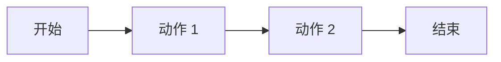

# /pm-solution — 业务方案拆解 Agent（Module 3）

> **端到端 6 模块流水线的第 2 站**
>
> /pm-clarify →【本命令】→ /pm-prototype → /prd → /pm-tech-spec → /pm-archive

## 一句话

**把《需求澄清报告》变成一份可动手做的业务方案**——含主流程、异常流程、功能清单（P0/P1/P2）、角色权限、依赖与风险。

## 输入

```bash
# 最常见：接第 2 站输出（默认路径）
/pm-solution ./output/pm-pipeline/{topic}-{date}/01-clarify-report.md

# 也可以直接给一段业务描述（跳过澄清阶段）
/pm-solution "支持财务批量导入发票并自动核销"

# 指定产品类型（影响权限模板 + 流程模板）
/pm-solution 01-clarify-report.md --product-type saas-b
```

## 内部两个子 Agent（顺序执行）

### Agent 3-1：业务方案拆解

**输入**：需求澄清报告（或原始需求描述）

**输出**：
1. **主业务流程**（happy path，含 5-9 个关键动作）
2. **分支流程**（合理的分支处理，如"审批不通过、部分成功"）
3. **异常流程**（网络异常、并发冲突、权限不足、数据缺失）
4. **功能清单**：分模块罗列，每项打 P0 / P1 / P2 标
5. **本次版本包含 / 不包含**（明确划线）
6. **用户角色 & 权限边界**（角色 × 功能 矩阵）

### Agent 3-2：风险 & 依赖识别

**输出**：
- **业务依赖**（上游流程、组织决策、数据源）
- **外部第三方依赖**（第三方邮件服务、登录、支付、AI 大模型 API）
- **潜在业务风险**（合规、口碑、竞争、政策）
- **技术依赖**（现有系统、账号体系、数据库）

## Harness 卡点

- **优先级 gate**：Agent 3-1 输出功能清单后 **强制** AskUserQuestion：
  ```
  自动生成的 P0/P1/P2 分级如下：
    P0（{n} 个）：核心，本次必须做
    P1（{m} 个）：重要，可能延后
    P2（{k} 个）：探索，本次不做
  是否需要人工调整？(y / n / edit)
  ```
- **风险确认 gate**：识别到"高严重度依赖"（如私有部署 AI 模型、跨境合规、招投标）时暂停，等 PM 确认后再进入 M4。

## 输出格式

```markdown
# 业务方案：{{topic}}

> 上游澄清报告：01-clarify-report.md
> 生成时间：{{yyyy-mm-dd hh:mm}}
> 产品类型：{{saas-b / c-end / internal}}

## 1. 一句话方案
（我们要给谁做什么，用什么方式，产生什么价值）

## 2. 主业务流程


### 2.1 步骤说明
| # | 动作 | 角色 | 输入 | 输出 | 关键规则 |
|---|---|---|---|---|---|

## 3. 分支流程
（列出 2-4 个合理分支，如"审批不通过""部分成功""转人工"）

## 4. 异常流程
| 场景 | 触发条件 | 系统处理 | 用户提示 | 兜底 |
|---|---|---|---|---|

必须覆盖至少：
- [ ] 网络中断 / 超时
- [ ] 权限不足
- [ ] 数据不合规 / 校验失败
- [ ] 并发冲突 / 幂等
- [ ] 外部依赖不可用

## 5. 功能清单
### 5.1 分模块罗列
| 模块 | 功能 | 优先级 | 简述 | 依赖 |
|---|---|---|---|---|
| 模块 A | 功能 A1 | P0 | ... | 模块 B |
| 模块 A | 功能 A2 | P1 | ... | — |

### 5.2 本次版本包含
（P0 全部 + P1 中已锁定的）

### 5.3 本次版本不包含
（P1 未锁定、P2 全部；必须显式列出）

## 6. 用户角色 & 权限边界
### 6.1 角色定义
| 角色 | 描述 | 数量级 | 关键动作 |
|---|---|---|---|

### 6.2 权限矩阵
| 角色 \ 功能 | 功能 A1 | 功能 A2 | 功能 B1 |
|---|:---:|:---:|:---:|
| 财务主管 | ✅ | ✅ | 只读 |
| 财务专员 | ✅ | ❌ | ❌ |
| 审计 | 只读 | 只读 | 只读 |

## 7. 业务依赖
- 上游流程：
- 组织决策：
- 数据源：

## 8. 外部第三方依赖
| 依赖 | 用途 | 关键指标 | 失败降级 |
|---|---|---|---|
| 第三方邮件（如 SendGrid） | 验证码 | QPS / 到达率 | 短信兜底 |
| ... | ... | ... | ... |

## 9. 潜在业务风险
| # | 风险 | 类型 | 概率 | 影响 | 缓解 |
|---|---|---|---|---|---|

分类必须覆盖：
- [ ] 合规 / 法务
- [ ] 商业（收入、竞争、客户流失）
- [ ] 交付（时间、质量、人力）
- [ ] 组织（跨部门协调、决策链）

## 10. 假设与开放问题
| # | 项 | 归属 | 触发点 |
|---|---|---|---|

## 11. 推荐下一步
- [ ] 认可业务方案 → `/pm-prototype ./output/.../02-business-solution.md`
- [ ] 优先级需调整 → 回到本命令 `--refine "P0 移除 X，加入 Y"`
- [ ] 澄清报告有遗漏 → 回到 `/pm-clarify --refine`

## 附：调用的 Skill
- pm-solution-decompose（业务流程 + 优先级 + 依赖识别）
- pm-prioritization-frameworks（RICE / MoSCoW / Kano）
- pm-discovery-frameworks（JTBD 场景卡）
```

## 与其他命令的边界

| 场景 | 用 |
|---|---|
| **有澄清报告 → 出可执行方案** | 本命令 |
| 未澄清就想拆功能 | 先跑 `/pm-clarify` |
| 生成原型 | 下一步 `/pm-prototype` |
| 需要一键跑完整 6 模块流水线 | `/pm-pipeline` |

## 反模式

- ❌ 只列 P0 不写"不包含"——违规
- ❌ 权限矩阵缺角色或功能——违规
- ❌ 异常流程覆盖 < 5 项——违规
- ❌ 依赖清单没写"失败降级"——违规
- ❌ 主流程画在文字里没画 Mermaid——违规
