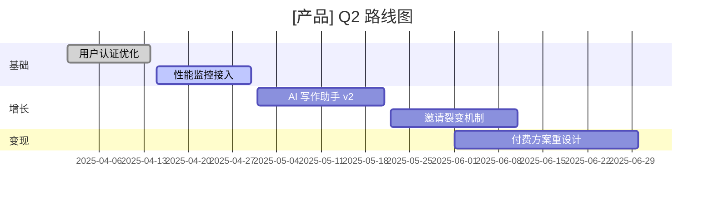

# /roadmap — 产品路线图规划

加载技能：`skills/strategy/product-roadmap/SKILL.md`

## 触发条件
规划季度 / 半年 / 年度产品路线图、对 Backlog 做需求优先级排序、生成 Gantt 图、同步 GitHub Projects 时。

## 参数说明

| 参数 | 说明 | 默认值 |
|------|------|--------|
| `<产品/团队描述>` | 产品名称或背景（必填） | — |
| `--mode` | 规划模式 | `plan` |
| `--horizon` | 规划周期 | `3m` |

### 规划模式（已聚焦）
| `--mode` | 输出内容 | 适用场景 |
|----------|---------|---------|
| `prioritize` | 需求优先级排序（RICE / MoSCoW / ICE） | Backlog 梳理 |
| `plan` | 路线图结构（主题 + 里程碑 + 交付物） | 季度/年度规划 |
| `gantt` | Mermaid Gantt 图 | 可视化展示 |
| `github` | GitHub Projects 配置方案 | 工程团队协作 |

## 参考工具生态

| 工具 | 特点 | GitHub |
|------|------|--------|
| Eververse | AI 驱动产品路线图 | haydenbleasel/eververse |
| gitlab-roadmap | GitLab 路线图组件 | eventOneHQ/gitlab-roadmap |
| mcp-github-project-manager | GitHub Projects MCP 集成 | kunwarVivek/mcp-github-project-manager |
| Plane | 开源 Linear 替代，Issue + Cycle + Module | makeplane/plane |
| Huly | 全能协作平台（类 Linear + Notion） | hcengineering/huly |
| OpenProject | 企业级开源项目管理 | opf/openproject |
| Focalboard | 开源 Trello/Notion DB 替代 | mattermost/focalboard |
| Tegon | AI 原生问题追踪工具 | RedPlanetHQ/tegon |
| Devlane | 研发效能看板 | Devlaner/devlane |
| Taiga | 开源敏捷项目管理 | kaleidos-ventures/taiga-back |

## 执行流程（plan 模式）

```
Step 1: 战略对齐
  → 确认当前阶段（0→1 / 1→10 / 扩张）
  → 关键商业目标（收入/留存/新用户/降本）
  → 约束条件（人力/时间/技术依赖）

Step 2: 需求梳理
  → 需求分类（New Feature / Enhancement / Bug / Tech Debt）
  → 优先级评分（RICE: Reach × Impact × Confidence ÷ Effort）
  → 依赖关系识别

Step 3: 主题规划
  → 定义季度主题（"增长季" / "稳定季" / "基础设施季"）
  → 按主题组织 Epic
  → 里程碑设置（M1/M2/M3）

Step 4: 资源分配
  → 研发带宽估算
  → 风险 Buffer 留存（建议 20%）
  → 团队对齐确认清单

Step 5: 可视化输出
  → Mermaid Gantt 图
  → 路线图文档
  → GitHub Projects 看板结构
```

## 输出示例（gantt 模式）



## 使用示例

```
/roadmap 为 AI SaaS 产品规划 Q2 路线图
/roadmap 对积压的 20 个需求做优先级排序 --mode prioritize
/roadmap 生成 H2 半年路线图 Gantt 图 --mode gantt --horizon 6m
/roadmap 配置 GitHub Projects 看板结构 --mode github
```

## 推荐工作流（季度规划 → Sprint）

```
1. /product-strategy --mode northstar（北极星 + 战略主题）
2. /roadmap --horizon 3m（基于战略主题排里程碑）
3. /roadmap --mode prioritize（Backlog 优先级 RICE）
4. /roadmap --mode gantt（输出可视化）
```
