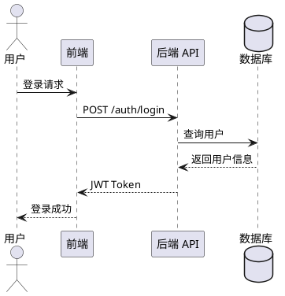
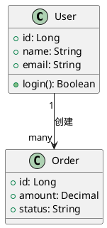
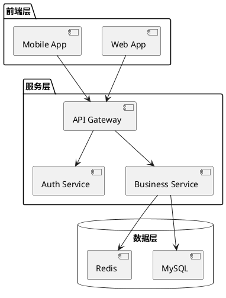
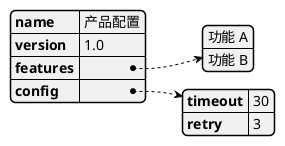

# Diagram PlantUML — UML 全系

> 单一职责：用 PlantUML 生成 UML 各类图表。
> 不做：思维导图（→ `diagram-markmap`）、轻量流程图（→ `mermaid-chart`）、云架构图（→ `arch-diagram`）

## 适用场景

- 软件架构设计文档
- 系统交互说明
- 数据库设计
- 业务流程规范化

## 图表类型与语法

### 时序图（Sequence）



### 类图（Class）



### 组件/架构图（Component）



### JSON/YAML 可视化



## 渲染方式

```bash
# 方式 1：在线渲染
# https://www.plantuml.com/plantuml/uml/

# 方式 2：本地 JAR
java -jar plantuml.jar diagram.puml        # 生成 PNG
java -jar plantuml.jar -tsvg diagram.puml  # 生成 SVG
java -jar plantuml.jar -tpdf diagram.puml  # 生成 PDF

# 方式 3：VSCode 插件
# 安装 "PlantUML" 插件，Alt+D 预览
```

## 质量基线

```
✓ 时序图：参与者 ≤ 6 个，消息 ≤ 15 条
✓ 类图：单类方法 ≤ 10 个，关系明确（继承/聚合/组合）
✓ 组件图：分层清晰（前端/服务/数据），依赖方向一致
✓ 中文标签，技术词保留英文
```
