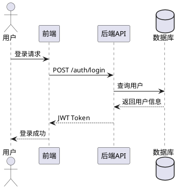
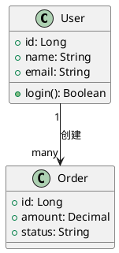
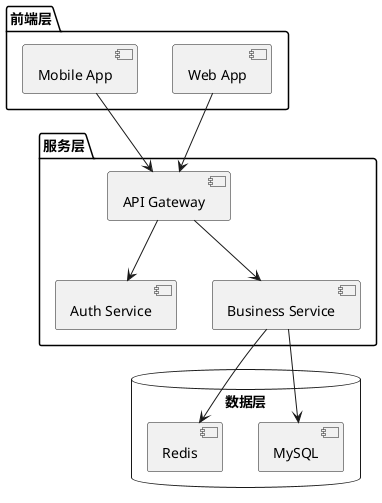
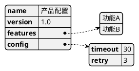
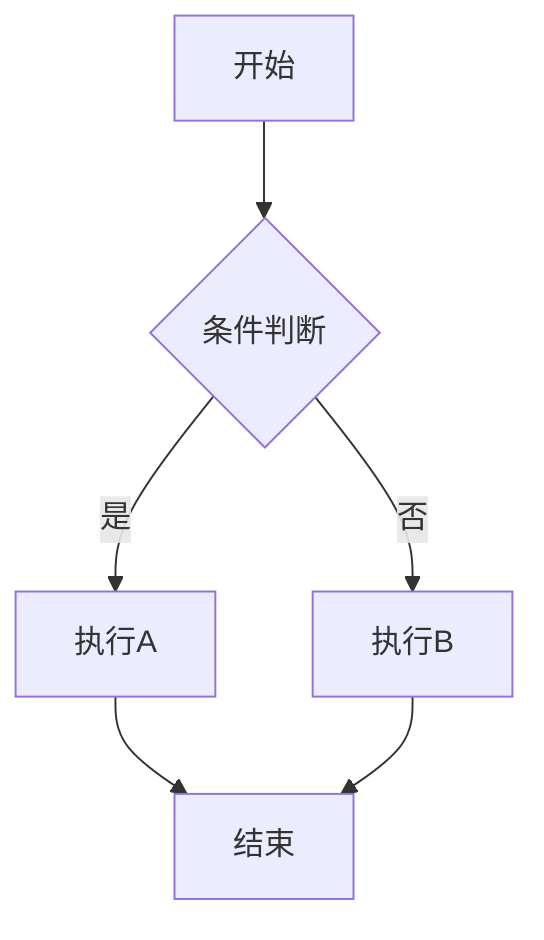
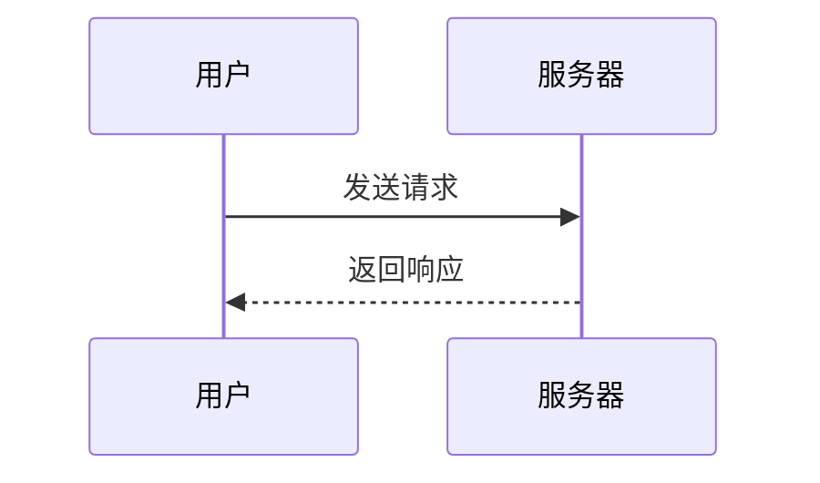
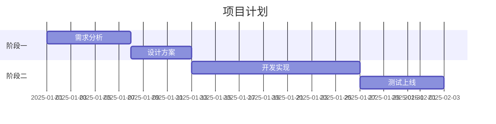
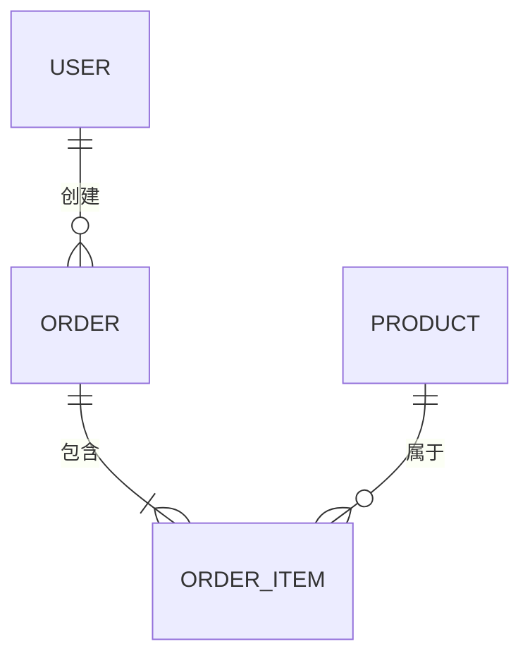

# Diagram Suite — 完整图表生成套件

> 整合来源：markmap、plantuml、mermaid-js/mermaid、Chamidu0423/MerdiAi  
> 四引擎覆盖：思维导图 / UML全系 / 文本图表 / AI自然语言生成

---

## 一、引擎选型速查

| 引擎 | 最适合 | 输出格式 | 特点 |
|------|--------|---------|------|
| **Markmap** | 思维导图、知识树、大纲可视化 | SVG/HTML/PNG | Markdown直接转换，层级清晰 |
| **PlantUML** | UML全系、架构图、JSON/YAML可视化 | PNG/SVG/PDF | Java驱动，最全面的UML支持 |
| **Mermaid** | 流程图、时序图、甘特图、ER图 | SVG/PNG | 轻量，GitHub原生支持，语法简洁 |
| **MerdiAi** | 自然语言→图表（AI驱动） | SVG/PNG | 支持OpenAI/Anthropic/OpenRouter |

---

## 二、引擎路由逻辑

```
输入类型判断
  ├── "思维导图/mindmap/知识树/大纲/层级结构"
  │   → Markmap 引擎
  │
  ├── "UML/类图/用例图/组件图/部署图/活动图/对象图"
  │   → PlantUML 引擎
  │
  ├── "流程图/时序图/甘特图/ER图/状态图/用户旅程/Git图"
  │   → Mermaid 引擎
  │
  ├── "自然语言描述图表/AI生成/帮我画一个..."
  │   → MerdiAi 引擎（生成Mermaid代码后渲染）
  │
  └── 不明确 → 优先 Mermaid（最通用），询问确认
```

---

## 三、Markmap — 思维导图引擎

### 适用场景
- 文章/报告大纲可视化
- 知识体系梳理
- 会议记录结构化
- 产品功能树

### 语法规范
```markdown
# 根节点（中心主题）

## 一级分支
### 二级分支
- 叶节点
  - 子叶节点

## 另一个一级分支
### 子分支
- 内容A
- 内容B
```

### 渲染方式
```bash
# 方式1：在线 REPL（推荐）
# 访问 https://markmap.js.org/repl 粘贴 Markdown 即可

# 方式2：CLI 安装
npm install -g markmap-cli
markmap input.md                    # 生成 input.html
markmap input.md --output out.svg   # 导出 SVG

# 方式3：VSCode 插件
# 安装 "Markmap" 插件，Ctrl+Shift+P → "Open as Markmap"
```

### 高级特性
```markdown
---
markmap:
  colorFreezeLevel: 2    # 冻结颜色层级
  maxWidth: 300          # 节点最大宽度
  initialExpandLevel: 2  # 初始展开层级
---

# 带配置的思维导图
## 分支1
- 支持 **加粗**、*斜体*、`代码`
- 支持 [链接](https://example.com)
- 支持 $LaTeX$ 数学公式
```

---

## 四、PlantUML — UML全系引擎

### 适用场景
- 软件架构设计文档
- 系统交互说明
- 数据库设计
- 业务流程规范化

### 图表类型与语法

#### 时序图（Sequence）


#### 类图（Class）


#### 组件/架构图（Component）


#### JSON/YAML 可视化


### 渲染方式
```bash
# 方式1：在线渲染
# https://www.plantuml.com/plantuml/uml/

# 方式2：本地 JAR
java -jar plantuml.jar diagram.puml        # 生成 PNG
java -jar plantuml.jar -tsvg diagram.puml  # 生成 SVG
java -jar plantuml.jar -tpdf diagram.puml  # 生成 PDF

# 方式3：VSCode 插件
# 安装 "PlantUML" 插件，Alt+D 预览
```

---

## 五、Mermaid — 轻量图表引擎

### 适用场景
- GitHub/GitLab 文档内嵌图表
- 技术博客配图
- 快速原型图表

### 核心图表类型

#### 流程图（Flowchart）


#### 时序图（Sequence）


#### 甘特图（Gantt）


#### ER图（Entity Relationship）


### 渲染方式
```bash
# 方式1：GitHub Markdown 原生支持（直接写 ```mermaid 代码块）

# 方式2：CLI
npm install -g @mermaid-js/mermaid-cli
mmdc -i input.mmd -o output.png
mmdc -i input.mmd -o output.svg

# 方式3：在线编辑器
# https://mermaid.live
```

---

## 六、MerdiAi — AI自然语言生成图表

### 适用场景
- 不熟悉图表语法，用自然语言描述
- 快速原型，后续手动调整
- 从文本/需求文档自动生成图表

### 使用方式
```
# 本地部署（Next.js）
git clone https://github.com/Chamidu0423/MerdiAi
npm install && npm run dev
# 访问 http://localhost:3000

# 配置 LLM（.env）
OPENAI_API_KEY=...
ANTHROPIC_API_KEY=...
OPENROUTER_API_KEY=...
```

### 提示词模板（直接调用 Claude 生成 Mermaid）
```
请根据以下描述生成 Mermaid 图表代码：

描述：[用户的自然语言描述]

要求：
1. 选择最合适的图表类型（flowchart/sequenceDiagram/classDiagram/erDiagram/gantt）
2. 节点标签使用中文
3. 代码简洁，不超过30个节点
4. 只输出 Mermaid 代码块，不要解释

```mermaid
[生成的代码]
```
```

---

## 七、输出规范

```
标准输出物：
├── 图表代码（Mermaid/PlantUML/Markmap 语法）
├── 渲染说明（推荐渲染方式 + 在线链接）
├── PNG/SVG 文件（如有 CLI 工具可用）
└── 嵌入 Markdown 的代码块（可直接复制使用）

质量标准：
✓ 节点数量适中（流程图 ≤ 20节点，思维导图 ≤ 4层）
✓ 标签简洁（≤ 10字/节点）
✓ 方向合理（TD 从上到下 / LR 从左到右）
✓ 颜色/样式与内容语义匹配
```
