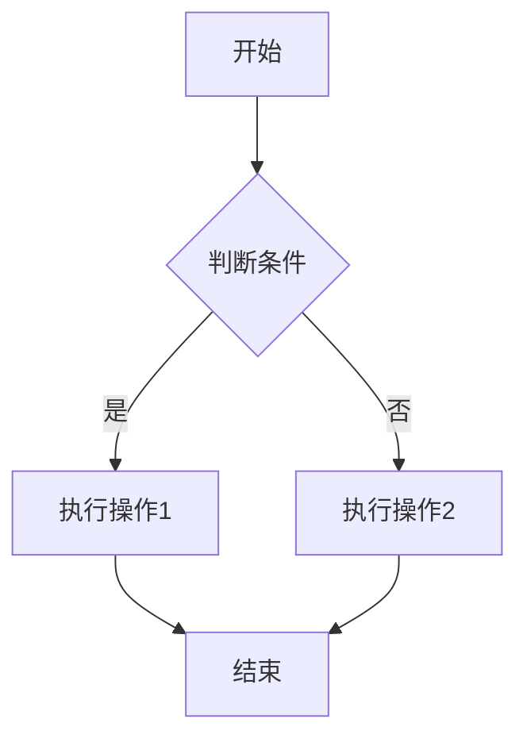
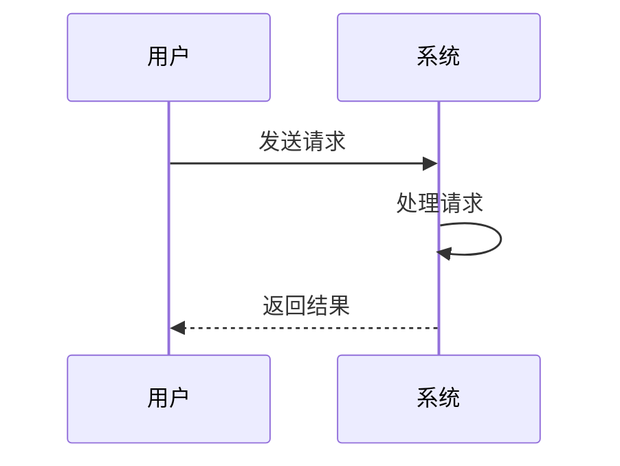
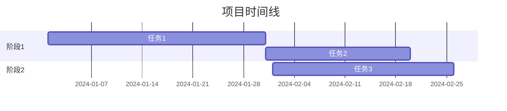

# Mermaid Chart Generator

## 概述
使用 Mermaid 语法生成各类图表，支持流程图、时序图、甘特图、类图、状态图等多种图表类型。

## 核心能力
- 流程图（Flowchart）
- 时序图（Sequence Diagram）
- 甘特图（Gantt Chart）
- 类图（Class Diagram）
- 状态图（State Diagram）
- ER 图（Entity Relationship Diagram）
- 用户旅程图（User Journey）
- Git 图（Git Graph）
- 饼图（Pie Chart）
- 思维导图（Mindmap）

## 使用场景
1. **文章配图** - 为技术文章生成流程图、架构图
2. **PPT 图表** - 为演讲生成可视化图表
3. **项目文档** - 生成项目流程、时间线、架构图
4. **数据可视化** - 将数据转换为图表展示

## 工作流程

### 1. 需求分析
- 理解用户需求（图表类型、内容、风格）
- 确定最适合的 Mermaid 图表类型
- 规划图表结构和层次

### 2. 生成 Mermaid 代码
根据图表类型生成对应的 Mermaid 语法：

**流程图示例**：


**时序图示例**：


**甘特图示例**：


### 3. 优化和调整
- 调整布局和样式
- 添加颜色和主题
- 优化可读性

### 4. 输出交付
- 提供 Mermaid 代码
- 说明如何渲染（Markdown、在线工具、VS Code 插件）
- 提供预览链接（可选）

## Mermaid 语法速查

### 流程图方向
- `graph TD` - 从上到下
- `graph LR` - 从左到右
- `graph BT` - 从下到上
- `graph RL` - 从右到左

### 节点形状
- `[矩形]` - 矩形
- `(圆角矩形)` - 圆角矩形
- `([体育场形])` - 体育场形
- `[[子程序]]` - 子程序
- `[(数据库)]` - 数据库
- `((圆形))` - 圆形
- `{菱形}` - 菱形
- `{{六边形}}` - 六边形
- `[/平行四边形/]` - 平行四边形
- `[\反向平行四边形\]` - 反向平行四边形
- `[/梯形\]` - 梯形
- `[\反向梯形/]` - 反向梯形

### 连接线类型
- `-->` - 实线箭头
- `---` - 实线
- `-.->` - 虚线箭头
- `-.-` - 虚线
- `==>` - 粗箭头
- `===` - 粗线

### 样式定义


## 最佳实践

1. **保持简洁** - 避免过于复杂的图表，必要时拆分
2. **清晰标注** - 使用有意义的节点名称和连接标签
3. **合理布局** - 选择合适的方向和层次结构
4. **统一风格** - 同一文档中保持图表风格一致
5. **添加注释** - 在代码中添加注释说明图表结构

## 渲染方式

### 1. Markdown 文件
直接在 Markdown 中使用 ` ```mermaid ` 代码块

### 2. 在线工具
- Mermaid Live Editor: https://mermaid.live/
- GitHub/GitLab - 原生支持 Mermaid

### 3. VS Code 插件
- Markdown Preview Mermaid Support
- Mermaid Editor

### 4. 导出图片
使用 mermaid-cli 导出为 PNG/SVG：
```bash
mmdc -i input.mmd -o output.png
```

## 输出格式

### 标准输出
```markdown
## [图表标题]

[图表说明文字]

```mermaid
[Mermaid 代码]
```

**使用说明**：
- 将代码复制到支持 Mermaid 的 Markdown 编辑器
- 或访问 https://mermaid.live/ 在线预览
```

## 注意事项
- Mermaid 语法对缩进敏感，注意格式
- 节点 ID 不能包含特殊字符
- 中文标签需要用引号包裹（可选）
- 复杂图表建议分层设计
- 测试渲染效果，确保兼容性

## 相关资源
- 官方文档: https://mermaid.js.org/
- 语法参考: https://mermaid.js.org/intro/syntax-reference.html
- 在线编辑器: https://mermaid.live/
