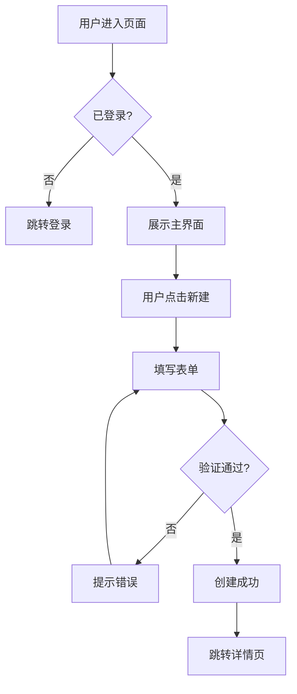

# PRD Generator — 产品需求文档知识库

## PRD 写作黄金原则

```markdown
1. 问题优先：先说清楚要解决什么问题，再说解法
2. 用户视角：每个功能点都能对应到用户需求
3. 可测试：验收标准用 Given/When/Then 写，开发和测试能直接用
4. 刚好够用：精炼而不精简，避免歧义但不过度设计
5. 活文档：PRD 随迭代更新，记录决策变更历史
```

## Lite PRD 模板（一页纸）

```markdown
# [功能名] — 一页纸 PRD

**日期**：YYYY-MM-DD | **作者**：[PM 姓名] | **状态**：草稿/评审中/已批准

## 背景与问题
[1-2句话说明背景，附关键数据支撑]
当前问题：[具体描述，附用户反馈或数据]

## 目标用户
[用户角色] 在 [场景] 下，需要 [需求]，但目前 [障碍]。

## 解决方案
[一句话描述方案]
核心功能（MVP）：
1. [功能 1]
2. [功能 2]
3. [功能 3]

## 成功指标
- 主指标：[指标名] 从 X% 提升到 Y%（[时间范围]内）
- 护栏指标：[不能变差的指标]

## 不在范围
- [排除项 1]
- [排除项 2]
```

## Full PRD 模板

```markdown
# [产品/功能名] PRD

**版本**：v1.0 | **状态**：[草稿/评审/已批准/已交付]
**PM**：[姓名] | **工程师**：[姓名] | **设计师**：[姓名]
**创建日期**：YYYY-MM-DD | **目标发布日**：YYYY-MM-DD

---

## 1. 概述

### 1.1 问题陈述
[描述用户痛点或业务机会，附数据]

### 1.2 解决方案摘要
[2-3 句话说明方案核心思路]

### 1.3 成功标准
| 指标 | 当前值 | 目标值 | 时间范围 |
|------|--------|--------|---------|
| [指标 1] | X | Y | 30天 |

---

## 2. 用户与场景

### 2.1 目标用户
**主要用户**：[画像描述]
**次要用户**：[画像描述]

### 2.2 使用场景
**场景 A（核心）**：
> [用户] 在 [时间/地点] 需要 [做某事]，因为 [原因]。

### 2.3 用户旅程（关键路径）
[步骤 1] → [步骤 2] → [步骤 3] → [Aha Moment]

---

## 3. 功能规格

### 3.1 功能 1：[名称]

**用户故事**：
As a [用户角色], I want to [行为], so that [目的].

**验收标准**：
- Given [前置条件], When [用户操作], Then [系统响应]
- Given [异常条件], When [用户操作], Then [错误处理]

**边界条件**：
- [限制/约束 1]
- [限制/约束 2]

---

## 4. 非功能需求
- **性能**：[响应时间要求]
- **安全**：[数据处理要求]
- **兼容性**：[浏览器/设备/OS]
- **可访问性**：[WCAG 级别]

---

## 5. 指标体系
- **北极星指标**：[指标名]
- **核心指标**：[指标 1]、[指标 2]
- **护栏指标**：[不能恶化的指标]
- **埋点需求**：[关键事件列表]

---

## 6. 发布计划
| 阶段 | 范围 | 时间 | 负责人 |
|------|------|------|--------|
| Alpha | 内测（10人） | W1-W2 | PM |
| Beta | 灰度（10%） | W3 | Eng |
| GA | 全量 | W4 | PM |

---

## 7. 风险与依赖
| 风险 | 概率 | 影响 | 缓解措施 |
|------|------|------|---------|
| [风险 1] | 高/中/低 | 高/中/低 | [缓解方案] |

---

## 8. 变更记录
| 日期 | 版本 | 变更内容 | 原因 |
|------|------|---------|------|
```

## GTM 计划模板

```markdown
# [产品/功能] GTM 计划

## 上线目标
- 商业目标：[目标]
- 成功指标：[指标]

## 目标客户细分
- 主要受众：[描述]
- 次要受众：[描述]

## 核心价值主张
[一句话：我们帮助 [用户] 解决 [问题]，通过 [方法]，不像 [竞品] 那样 [区别]。]

## 上线策略
| 渠道 | 内容 | 时间 | 负责人 |
|------|------|------|--------|
| 官网博客 | 功能介绍文章 | T-3天 | Content |
| Email | 现有用户通知 | T-1天 | Growth |
| 社交媒体 | 发布贴 | T+0 | Marketing |
| 产品内 | 弹窗/引导 | T+0 | PM |

## 定价策略
[描述定价逻辑，如有调整]

## 风险预案
- 如果 [风险]，则 [预案]
```

## 用户旅程 + Mermaid 流程图（workflow 模式）

```markdown
# 用户旅程：[功能名]

## 主要流程


## 情绪旅程
| 步骤 | 用户感受 | 优化机会 |
|------|---------|---------|
| 进入页面 | 🤔 迷茫 | 清晰的价值主张 |
| 注册 | 😤 摩擦 | 减少必填字段 |
| 首次使用 | 😊 满足 | 强化 Aha Moment |
```

## 功能决策框架

```markdown
拒绝一个需求的合理理由：
1. 不符合目标用户群
2. 解决的问题不够大（影响 <5% 用户）
3. 与产品定位/策略冲突
4. 技术成本高于用户价值
5. 可用第三方集成代替

接受一个需求的信号：
1. 多个高价值用户提出相同需求
2. 当前痛点导致明显流失
3. 竞品已有且用户明确对比
4. 解锁关键商业场景（企业/合规/集成）
```
