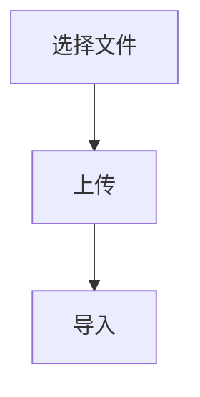
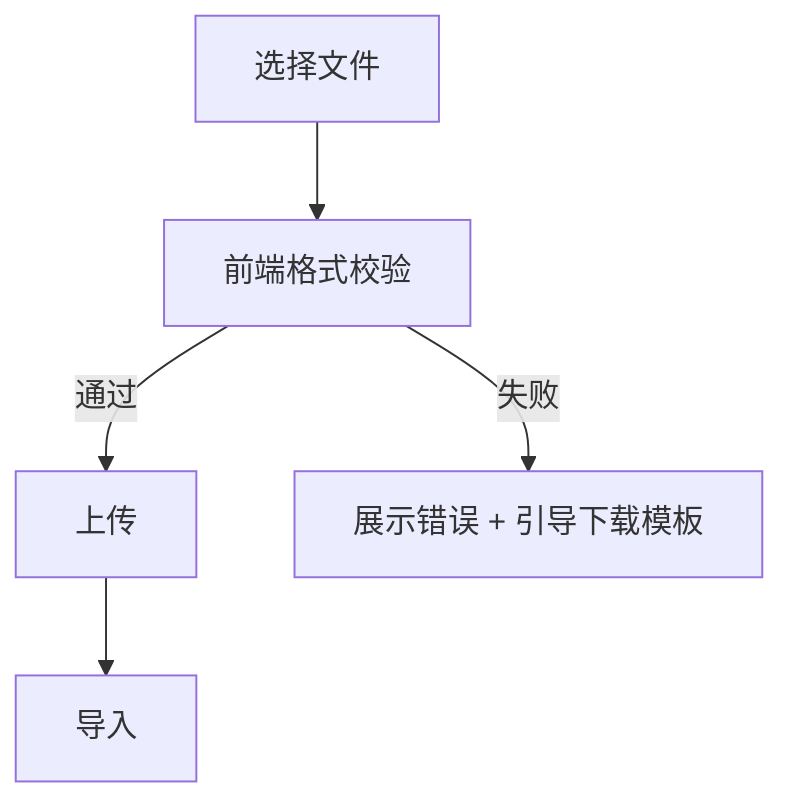

# Prd Incremental Update — PRD 增量合并更新

> 单一职责：不重写原文，只在原 PRD 上增量合并新增/变更内容。
> 不做：从零写 PRD（→ `prd-implementation-draft`）、评估（→ `prd-deep-evaluate` / `prd-quality-check`）

## 核心原则

```
1. 合并不覆盖：变更只打标记，原文保留
2. 影响传导：识别新增/变更对其他章节的影响（流程图、数据表、文案）
3. 影响范围最小化：只修改受影响章节，不动其他
```

## 执行流程

```
Step 1：获取现有文档（要求用户提供路径或粘贴内容）

Step 2：确认新增/变更的内容
  - 新增功能 / 修改功能 / 删除功能
  - 字段变更
  - 流程变更

Step 3：分析影响范围（通常涉及）
  - §5 需求范围（功能列表）
  - §8 业务流程
  - §9 功能详细说明
  - §11 字段说明
  - §13 状态流转
  - §14 校验规则
  - §15 文案规范
  - §18 埋点
  - §19 接口

Step 4：执行合并
  → 新增的功能：插入功能列表 + 新增详情章节
  → 变更的功能：在原有章节内修改，标注【本次更新】
  → 影响的用户流程：更新流程图
  → 影响的数据规格：更新数据表
  → 删除的功能：原章节用【本次更新】标注"已下线"，不删除

Step 5：合并后检查
  → 流程图是否更新到位？
  → 新增功能是否有完整的状态清单和边界条件？
  → 文案规范是否同步更新？
  → 接口和字段变更是否反映到 §19？
  → §1 版本号是否递增？
```

## 标记规范

```markdown
【本次更新】新增：[功能/字段/状态] — [一句话说明变更原因]
【本次更新】修改：[原有内容] → [新内容] — [变更原因]
【本次更新】删除：[删除的内容] — [删除原因]
【本次更新】下线：[功能名] — [下线原因 + 数据迁移说明]
```

## 输出示例

```markdown
## §9.3 批量导入功能（保持不变）

...原内容...

## §9.4 单条手动录入（保持不变）

...原内容...

【本次更新】新增章节
## §9.5 Excel 模板下载与校验
**变更原因**：客户工单反馈批量导入失败率 32%，多因字段格式错误

**功能说明**：用户在批量导入入口可下载标准 Excel 模板...
（按 §9.x.1/9.x.2/9.x.3/9.x.4 完整填写）

---

【本次更新】修改 §8.1 主流程图

旧流程：


新流程：


变更原因：增加前端格式预校验，降低失败率
```

## 变更追溯

每次增量更新必须在 §1 文档信息 - 版本变更记录中追加一行：

```
| v1.2 | 2026-06-17 | [作者] | 新增 §9.5 Excel 模板，修改 §8.1 主流程 | 客户反馈批量导入失败率高 |
```
