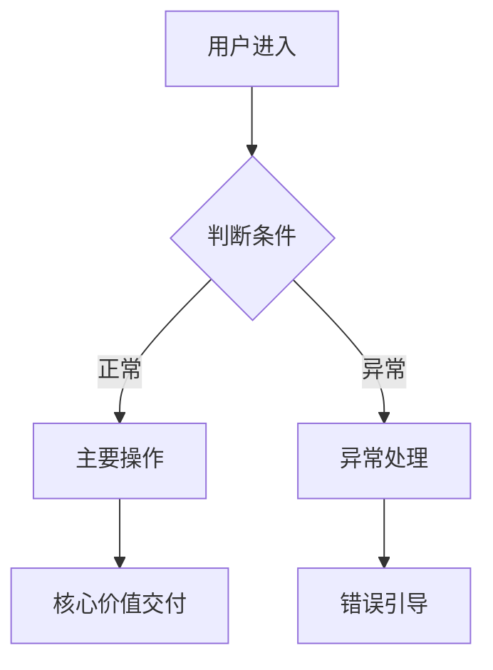

# PRD Writer — 对话式 PRD 引导写作知识库

> 来源：[chituai/prd-writer](https://github.com/chituai/prd-writer)（MIT License）
> 核心理念：先对齐方向，再展开细节；用对话挖掘，而非表格填充

---

## 设计哲学

```
1. 先验方向，再展细节    概念稿对齐后才写实现稿，避免在错误方向上浪费精力
2. 两阶段交付闸门       概念稿 → 确认 → 实现稿，每阶段都有人工闸门
3. 三镜诊断            每个产品想法必须通过：用户视角 + 商业视角 + 技术视角
4. 主动填补盲区        自动补充非 PM 用户容易遗漏的内容（状态机/边界/数据规格/文案）
5. 双受众文案分离      开发/AI 看的技术说明 vs 用户看的界面文案，独立定义
6. 合并不覆盖         Mode C 增量更新时只打标记，不重写原文
7. 用 [待补充] 代替猜测  信息不足时标注而非编造
```

---

## 模式识别

| 用户情况 | 自动路由 |
|---------|---------|
| 有想法，没有文档 | Mode A：两阶段引导生成 |
| 有现有文档，要评估/优化 | Mode B：三层评分 + 改进建议 |
| 有现有文档，要增加功能 | Mode C：增量合并，标记变更 |

---

# MODE A：从零开始引导生成

## Step 0：资质核查

先问用户说清楚核心想法，再开始：

> "能先跟我说说你这个产品/功能的核心想法是什么吗？一两句话就好——想解决谁的什么问题？"

| 用户回应 | 判断 | 处理方式 |
|---------|------|---------|
| 能说清楚谁/用什么/怎么更好 | ✅ 可以继续 | 进入 Step 1 |
| 模糊但有方向 | ⚠️ 需引导 | 追问 1-2 个定向问题 |
| 完全没有方向 | ❌ 还没准备好 | 建议先思考：解决什么问题？谁有这个问题？ |

---

## Step 1：三镜诊断

每次只问 1-2 个问题，对话式推进，不要一次抛出所有问题。

### 镜头一：用户视角

```
核心问题（选 1-2 个追问）：
- 用户现在怎么解决这个问题？用什么工具/方法？
- 你的方案比现有方式好在哪里？好到值得让用户换吗？
- 你跟真实用户聊过吗？他们怎么说？
- 会用这个产品的人，一天会用几次？在什么场景下用？
```

### 镜头二：商业视角

```
核心问题（选 1-2 个追问）：
- 这个产品怎么赚钱？免费增值/订阅/按次付费/广告？
- 已有竞品吗？你跟他们的差异是什么？
- 目标用户规模大概多少？够撑起一个产品吗？
- 做这个产品的目的是什么？是商业变现、积累用户，还是内部工具？
```

### 镜头三：技术视角

```
核心问题（选 1-2 个追问）：
- 你们有这个产品需要的核心技术能力吗？
- 你觉得最难实现的功能是哪个？
- 如果只做一个核心功能先上线，是哪个？（MVP 思维）
- 预计上线时间线是多久？
```

### 产品形态建议（如用户未确定）

| 产品形态 | 最适合场景 | 限制 |
|---------|-----------|------|
| Web App | 复杂功能/B2B 工具/最快上线 | 移动体验弱 |
| 微信小程序 | 中国用户/社交裂变/免安装 | 功能受限/依赖微信 |
| 原生 App | 高频使用/需要设备能力/清晰变现模型 | 开发周期长/需过审 |
| AI 插件/技能 | 增强现有工具/不适合独立产品 | 依赖宿主平台 |

诊断完成后：**汇总理解并请用户确认，再继续。**

---

## Step 2：输出概念稿（Version 1）

目标：**方向对齐，不展细节**。篇幅控制在 1 页以内。

```markdown
# [产品名] — 概念文档 v1

**一句话定位**
[目标用户] 使用 [产品形态]，解决 [核心问题]，
相比 [现有方案]，我们 [差异化优势]。

---

## 产品形态
[选择的形态] + 选择理由 + 分阶段策略（如有）

## 目标用户
- 核心用户：[1-2 个画像] + 核心痛点
- 为什么他们会用这个产品而不是别的？

## 产品价值
- 用户价值：[直接解决的问题]
- 商业逻辑：[变现方式/业务目标]

## 核心功能方向（不展细节）
1. [功能方向 A]
2. [功能方向 B]
3. [功能方向 C]

## 本次不做
- [排除项 1]：原因
- [排除项 2]：原因

## 待解决的关键问题
- [ ] [尚未有答案的问题 1]
- [ ] [尚未有答案的问题 2]
```

**交付后**：请用户确认方向，或提出修改意见，迭代至对齐后再继续。

> "以上是基于你的描述梳理出的产品方向，请确认：方向是否准确？有哪些需要调整？"

---

## Step 3：输出实现稿（Version 2）

**只在概念稿确认后执行**。目标：详细到可以直接交给 AI 或研发开始构建。

### 文档结构

```markdown
# [产品名] PRD v1.0

---

## 1. 产品概述（继承自概念稿）

一句话定位 / 产品形态 / 核心用户 / 产品价值

---

## 2. 目标用户与使用场景

### 用户画像
| 维度 | 描述 |
|------|------|
| 身份 | [职业/年龄/技能水平] |
| 使用场景 | [什么情况下用这个产品] |
| 核心诉求 | [他们最想解决什么] |
| 担忧 | [他们最担心什么] |

### 典型使用场景（2-3 个）
**场景 A（核心路径）：**
- 谁：[用户类型]
- 情境：[什么时候/什么状态]
- 动作：[用户做了什么]
- 期望结果：[他们希望发生什么]

---

## 3. 核心用户流程

（Mermaid 流程图，覆盖主路径 + 1-2 个异常分支）



---

## 4. 功能列表

（树状结构，标注优先级）

```
🔴 核心功能（MVP 必须有）
  ├── [功能 A]
  │   ├── [子功能 A1]
  │   └── [子功能 A2]
  └── [功能 B]

🟡 重要功能（后续版本）
  └── [功能 C]

⚪ 未来考虑
  └── [功能 D]
```

### 4.1 关键页面线框图（ASCII）

（核心页面的结构草图，展示导航、内容区域、主要交互元素的位置关系）

---

## 5. 功能详情（每个 🔴 核心功能一节）

### 5.x [功能名]

**功能描述**：[一句话说明这个功能做什么]
**触发条件**：[什么情况下用户会用到这个功能]

**交互细节**
- 操作反馈：[用户操作后立即看到什么]
- 破坏性操作确认：[删除/覆盖等操作的二次确认文案]
- 空态引导：[没有数据时展示什么，引导用户做什么]
- 失败引导：[出错时展示什么，给用户什么操作选择]

**状态清单**

| 状态 | 触发条件 | 展示内容 |
|------|---------|---------|
| 默认态 | 正常有数据时 | [展示内容] |
| 加载中 | 请求进行中 | 骨架屏/Loading 动画 |
| 成功 | 操作完成 | Toast / 跳转 / 刷新 |
| 失败 | 接口错误/权限不足 | 错误提示 + 操作建议 |
| 禁用 | 无权限/条件未满足 | 灰态 + 说明文案 |
| 空态 | 无数据 | 空态插图 + 引导操作 |

**边界条件**
- 空内容输入：[处理方式]
- 内容溢出：[截断规则，如最多 200 字符]
- 网络异常：[降级策略，如本地缓存/重试]
- 无权限：[提示文案 + 操作引导]
- 并发冲突：[多用户同时操作时如何处理]
- 格式不匹配：[上传格式限制/类型校验]

**数据规格**

| 字段名 | 类型 | 长度/范围 | 必填 | 默认值 | 格式/验证规则 |
|--------|------|----------|------|--------|-------------|
| [字段] | String/Int/Boolean | [N] | 是/否 | [默认] | [规则] |

---

## 6. 文案规范

### 6.1 整体产品语气
[专业/友好/简洁/活泼] — [一句话描述产品的说话方式]

### 6.2 技术说明文案（面向开发/AI）

| 位置 | 技术说明 |
|------|---------|
| 字段 `user_id` | 用户唯一标识，UUID 格式 |
| 接口 `POST /items` | 创建新记录，返回 `item_id` |

### 6.3 用户界面文案（面向终端用户）

| 位置 | 文案内容 | 备注 |
|------|---------|------|
| 主按钮 | [文案] | ≤6字，动词开头 |
| 空态标题 | [文案] | ≤15字，积极语气 |
| 成功提示 | [文案] | 简短，说明完成了什么 |
| 错误提示 | [文案] | 说明问题 + 建议操作 |
| 删除确认 | [文案] | 明确说明不可撤销 |
| 加载中 | [文案] | 如"正在处理..." |

---

## 7. 非功能需求

- **性能**：[接口响应时间/页面加载时间要求]
- **权限**：[不同角色的功能访问范围]
- **兼容性**：[支持的浏览器/设备/系统版本]
- **数据安全**：[敏感字段的存储/传输要求]
- **存储**：[数据量估算/文件大小限制]

---

## 8. 待解决问题

- [ ] [尚未决策的问题 1]（截止：[日期]，决策人：[姓名]）
- [ ] [尚未决策的问题 2]
```

---

# MODE B：评估现有文档

接收用户的现有 PRD，执行三层评分检查，每项标注 ✅ / ❌ / ⚠️。

## 三层评分清单

### 第一层：方向层（判断产品方向是否清晰）

| 检查项 | 标准 |
|--------|------|
| 目标用户 | 是否有具体画像，不是"所有人"或"普通用户" |
| 一句话定位 | 能否一句话说清楚：谁/用什么/解决什么/差异是什么 |
| 产品形态选择 | 是否有形态选择和理由，而非默认"做个 App" |
| 商业价值 | 是否说明了产品的盈利逻辑或业务价值 |
| 范围边界 | 是否明确说了"不做什么"以及原因 |

### 第二层：结构层（判断文档结构是否完整）

| 检查项 | 标准 |
|--------|------|
| 用户流程图 | 是否有主路径 + 异常分支的流程图 |
| 优先级功能列表 | 是否有 🔴/🟡/⚪ 的功能分级 |
| 关键页面线框图 | 核心页面是否有布局草图 |
| 功能详情章节 | 每个核心功能是否有独立详细描述 |

### 第三层：细节层（判断细节是否足够支撑开发）

| 检查项 | 标准 |
|--------|------|
| 状态完整性 | 每个功能是否覆盖 6 种状态（默认/加载/成功/失败/禁用/空） |
| 边界条件 | 是否覆盖空输入/溢出/网络异常/无权限/并发 |
| 交互反馈 | 是否说明了每个操作的即时反馈 |
| 数据规格 | 核心字段是否有类型/长度/必填/验证规则 |
| 文案分离 | 技术说明文案和用户界面文案是否分开定义 |

## 输出格式

```markdown
## PRD 评估报告

**总分：[X]/10**

### 第一层：方向层 — [X]/10
✅ [通过项]：[简短说明]
❌ [问题项]：[具体问题描述] → 建议：[如何改进]
⚠️ [待完善项]：[说明]

### 第二层：结构层 — [X]/10
（同上格式）

### 第三层：细节层 — [X]/10
（同上格式）

---

## 主要问题汇总（按优先级）
1. [最重要的问题] — 影响：[说明]
2. [次要问题]
3. [可选改进项]

---

你希望我帮你：
A. 直接补充/修改薄弱的章节
B. 对整个文档进行全面重写
C. 只给出改进建议，你自己来修改
```

---

# MODE C：增量合并更新

不重写原文，只在原文上增量合并，所有变更打 `【本次更新】` 标记。

## 执行流程

```
Step 1: 获取现有文档
Step 2: 确认新增/变更的内容是什么
Step 3: 分析影响范围（通常涉及：功能列表、用户流程、功能详情）
Step 4: 执行合并
  → 新增的功能：插入功能列表 + 新增详情章节
  → 变更的功能：在原有章节内修改，标注【本次更新】
  → 影响的用户流程：更新流程图
  → 影响的数据规格：更新数据表
Step 5: 合并后检查
  → 流程图是否更新到位？
  → 新增功能是否有完整的状态清单和边界条件？
  → 文案规范是否同步更新？
```

## 标记规范

```markdown
【本次更新】新增：[功能/字段/状态] — [一句话说明变更原因]
【本次更新】修改：[原有内容] → [新内容] — [变更原因]
【本次更新】删除：[删除的内容] — [删除原因]
```

---

# 通用写作规则

```
1. 不跳阶段    概念稿未确认前不写实现稿；方向诊断未完成前不写概念稿
2. 三镜必过    用户/商业/技术三个视角都必须有清晰答案
3. 主动填盲区  自动识别并补充用户没提到但开发需要知道的内容
4. 双受众分离  技术/开发说明 vs 用户界面文案，永远单独定义
5. 合并不覆盖  Mode C 更新时打标记，原文保留
6. 标注不猜测  信息不足时写 [待补充]，不要编造数据
7. 图表优先    能用流程图表达的不用文字，能用表格的不用列表
```

---

# 非 PM 用户常见盲区（自动填补）

以下内容在用户未提及时主动补充：

| 盲区类型 | 典型缺失 | 自动补充内容 |
|---------|---------|------------|
| 交互细节 | 只说"用户点击按钮" | 补充：点击后的即时反馈、加载态、成功/失败提示 |
| 状态机 | 只描述成功场景 | 补充：空态/加载/失败/禁用态的展示方案 |
| 数据规格 | 只说"有个输入框" | 补充：字段类型/长度/必填/验证规则 |
| 文案 | 把"button_submit"当作文案 | 区分技术字段名 vs 用户看到的文案 |
| 权限边界 | 只设计管理员视角 | 补充：不同角色看到什么/能做什么 |
| 边界条件 | 只描述正常情况 | 补充：空值/超限/网络异常/并发冲突 |
| 删除/覆盖确认 | 直接执行破坏性操作 | 补充：二次确认文案 + 不可撤销说明 |
