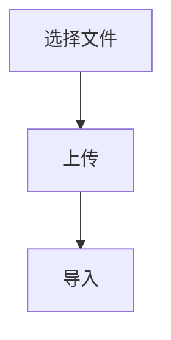
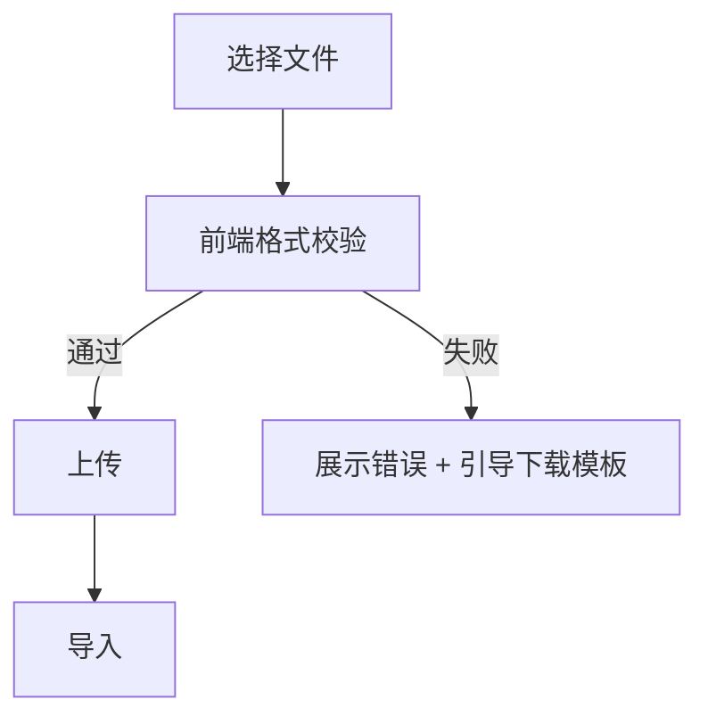

# PRD Writer — 通用 PRD 写作（唯一生成入口）

> **单一职责**：把想法或需求描述，落成研发/测试/UI/运营可直接使用的 PRD 文档，或对现有 PRD 做增量合并。
> **行业无关**：C 端、B 端 SaaS、内部工具、G 端、金融、电商、工具产品统一适用；不做任何行业专用模板。
> **能力覆盖**：写作（outline/feature/full）+ 变更（update）+ 增强（+wireframe/+engineering）+ 自检（A/B/C/D）。

---

## 一、核心方法论

### 1.1 PDF 10 项功能描述必备项（本 skill 的骨架）

每个功能模块的描述，**必须覆盖以下 10 项**，杜绝口头/模糊/遗漏需求：

| # | 项目 | 一句话定义 |
|---|------|-----------|
| 1 | 功能概述 | 为什么做、给谁用、解决什么问题 |
| 2 | 触发条件 / 入口 | 用户在哪里、通过什么操作触发 |
| 3 | 前置条件 | 触发前用户/系统必须满足的状态 |
| 4 | 核心操作流程 | 主流程 + 分支流程，step-by-step |
| 5 | 页面 / 元素说明 | UI 元素的展示规则、默认值、显隐条件 |
| 6 | 数据规则 | 录入/校验/存储/回显/联动/字段格式 |
| 7 | 异常场景 & 兜底 | 网络/参数/权限/超时/重复等异常处理 |
| 8 | 状态流转 | 页面/数据/按钮/弹窗的状态变化逻辑 |
| 9 | 权限控制 | 不同角色的可见/可操作/可编辑差异 |
| 10 | 埋点需求 | 事件名、触发时机、上报参数 |

> **规则**：10 项中 1–9 为必写；第 10 项在迭代产品中必写，MVP 首版可缓写。

### 1.2 写作四原则（PDF）

```
1. 无歧义：不用"大概/可能/优化/提升/尽快/合理/友好"等模糊词，所有规则可量化、可校验
2. 全覆盖：优先写异常场景，80% 的线上 bug 来自未定义的异常逻辑
3. 角色对齐：同时满足研发开发、测试用例、UI 设计、产品复盘的使用需求
4. 不冗余：只写功能逻辑，不写技术实现方式，技术方案由研发自行落地
```

---

## 二、四档模式：按场景选择

| 档位 | 适用场景 | 篇幅 | 内容深度 |
|------|---------|------|---------|
| **outline** | 早期想法对齐、立项前沟通、跨团队同步 | 1 页 | 背景/目标/MVP 功能列表（仅标题）/成功指标/不做 |
| **feature** | 单个功能点、可在一个迭代内完成、Linear/Jira Issue | 1–3 页 | 完整 10 项 + 影响范围 + 明确不做 + 变更记录 |
| **full** | 多功能完整 PRD、正式评审、跨部门交付 | 5–20 页 | 全局章节 + 每个功能用 10 项写 + 非功能 + 指标 + 发布 + 风险 |
| **update** | 已有 PRD 增量变更（新增/修改/下线功能） | 增量 | 原文保留 + 只改受影响章节 + 【本次更新】标记 |

### 2.1 outline 模板（1 页）

```markdown
# [产品/功能名] PRD - Outline

**版本**：v0.1 | **PM**：[姓名] | **日期**：YYYY-MM-DD

## 1. 背景
[1–3 句，附关键数据。谁的什么痛点、当前如何解决、有什么不足]

## 2. 目标用户
**主要**：[画像 + 场景 1 句话]
**次要**：[画像 + 场景 1 句话]

## 3. 核心目标
[本次要达成什么，1–3 条，可衡量]

## 4. MVP 功能清单（仅标题）
- [ ] 功能 1：[动词 + 对象]
- [ ] 功能 2：[动词 + 对象]
- [ ] 功能 3：[动词 + 对象]

## 5. 成功指标
| 指标 | 当前值 | 目标值 | 时间 |
|------|--------|--------|------|
| [北极星指标] | X | Y | 30 天 |

## 6. 明确不做
- [排除项 1]
- [排除项 2]
```

### 2.2 feature 模板（单功能详版，PDF 10 项完整应用）

```markdown
# [模块] 动词 + 对象

**版本**：v1.0 | **PM**：[姓名] | **状态**：[草稿/评审/已批准]

---

## 1. 功能概述
[一句话定义核心价值：为什么做、给谁用、解决什么问题。区分新旧功能、迭代范围]

## 2. 触发条件 / 入口
1. [具体入口路径 1 — 页面 + 元素位置]
2. [具体入口路径 2 — 自动触发条件 / 深链 / 快捷键]

## 3. 前置条件
1. [用户状态 — 登录/未登录/角色]
2. [系统状态 — 数据加载/版本/网络]
3. [业务前提 — 已完成 XX 步骤]

## 4. 核心操作流程

### 4.1 主流程（成功路径）
1. [用户/系统动作 + 界面反馈]
2. [用户/系统动作 + 界面反馈]
3. ...

### 4.2 分支流程
| 触发条件 | 处理逻辑 | 用户提示 |
|---------|---------|---------|
| [条件 1] | [处理] | [具体文案] |
| [条件 2] | [处理] | [具体文案] |

## 5. 页面 / 元素说明
| 元素 | 类型 | 默认值 / 占位 | 显隐规则 | 交互反馈 |
|------|------|-------------|---------|---------|
| [账号输入框] | 单行文本 | 请输入手机号/账号 | 常显 | 失焦校验 |
| [登录按钮] | 主按钮 | 置灰 | 常显 | 符合规则后高亮 |

## 6. 数据规则
| 字段 | 类型 | 必填 | 取值范围 | 默认值 | 精度/单位 | 备注 |
|------|------|------|---------|--------|----------|------|
| [账号] | string | 是 | 11 位手机号 or 6–20 位字母数字 | — | — | 首尾不含空格 |
| [密码] | string | 是 | 6–20 位字符 | — | — | 支持数字/字母/符号，禁纯空格 |

**校验时机**：输入完成失焦后实时校验，不符合规则即时展示文案提示

## 7. 异常场景 & 兜底处理
| 异常类型 | 处理逻辑 | 用户提示（准确文案） |
|---------|---------|------------------|
| 网络异常 | 取消加载态，保留输入 | "网络异常，请检查网络后重试" |
| 请求超时 | 允许重试 | "登录超时，请重新尝试" |
| 频繁操作 | 1 分钟内错 5 次锁定 1 分钟 | "操作频繁，请稍后再试" |
| 服务端异常 | 兜底提示，不暴露报错 | "系统繁忙，请稍后重试" |
| 数据为空 | 空态设计 | "[空态文案]" |
| 权限不足 | 跳转/提示 | "[准确文案]" |

## 8. 状态流转
| 状态 | 触发 | 界面表现 |
|------|------|---------|
| 初始 | 进入页面 | 输入框空、按钮置灰 |
| 输入中 | 有输入 | 内容不合规时显示红色提示 |
| 请求中 | 点击提交 | 按钮禁用 + 加载动画，禁重复点击 |
| 成功 | 后端返回成功 | 关闭动画 + 跳转 |
| 失败 | 后端返回失败 | 关闭动画 + 错误提示，保留输入 |

## 9. 权限控制
| 角色 | 可见 | 可操作 | 可编辑 |
|------|------|-------|-------|
| 游客 | 是 | 是 | — |
| 普通用户 | 是 | 是 | — |
| 管理员 | 是 | 是 | — |

## 10. 埋点需求
| 事件名 | 触发时机 | 上报参数 |
|-------|---------|---------|
| [login_click] | 点击登录按钮 | 触发时间、设备型号、结果、错误类型 |
| [login_page_view] | 页面曝光 | 停留时长、进入入口 |

---

## 附：影响范围
- 涉及模块：[列出]
- 是否影响存量功能：是 / 否 —— 说明：
- 是否需数据迁移：是 / 否 —— 说明：
- 老版本客户端表现：
- 是否涉及报表：

## 附：GWT 验收标准
- [ ] Given [前置条件]，When [用户操作]，Then [系统响应 + 具体数值/文案]
- [ ] Given [异常条件]，When [用户操作]，Then [错误处理 + 准确文案]
- [ ] Given [边界值]，When [用户操作]，Then [响应 + 数值]

## 附：明确不做（Out of Scope）
- [排除项 1]
- [排除项 2]

## 附：变更记录
| 日期 | 改了什么 | 为什么 | 确认人 |
|------|---------|-------|-------|
```

### 2.3 full 模板（多功能完整版）

```markdown
# [产品/功能名] PRD

**版本**：v1.0 | **PM**：[姓名] | **状态**：[草稿/评审/已批准/已交付]
**创建日期**：YYYY-MM-DD | **目标发布日**：YYYY-MM-DD

---

## 1. 概述

### 1.1 问题陈述
[用户痛点或业务机会，附数据]

### 1.2 解决方案摘要
[2–3 句话说明方案核心思路]

### 1.3 成功标准
| 指标 | 当前值 | 目标值 | 时间范围 |
|------|--------|--------|---------|

---

## 2. 用户与场景

### 2.1 目标用户
**主要**：[画像]
**次要**：[画像]

### 2.2 使用场景
**场景 A（核心）**：[用户] 在 [时间/地点] 需要 [做某事]，因为 [原因]

### 2.3 用户旅程
[步骤 1] → [步骤 2] → [Aha Moment]

---

## 3. 功能规格

> **每个功能模块严格按 PDF 10 项写**（沿用 2.2 feature 模板结构：功能概述 / 入口 / 前置 /
> 主流程 / 页面元素 / 数据规则 / 异常兜底 / 状态流转 / 权限 / 埋点）

### 3.1 功能一：[名称]
[完整 10 项 …]

### 3.2 功能二：[名称]
[完整 10 项 …]

---

## 4. 非功能需求
- **性能**：[X] 条数据下响应 ≤ [Y] 秒
- **安全**：[鉴权/加密/审计要求]
- **兼容性**：[浏览器/设备/OS 版本]
- **可访问性**：[WCAG 级别 / 键盘可达等]

## 5. 指标体系
- **北极星指标**：
- **核心指标**：
- **护栏指标**：
- **埋点事件汇总**：

## 6. 发布计划
| 阶段 | 范围 | 时间 | 负责人 |
|------|------|------|--------|
| Alpha | 内测 | | |
| Beta | 灰度 | | |
| GA | 全量 | | |

## 7. 风险与依赖
| 风险 | 概率 | 影响 | 缓解措施 |
|------|------|------|---------|

## 8. 变更记录
| 日期 | 版本 | 变更内容 | 原因 |
|------|------|---------|------|
```

### 2.4 update 模式（增量合并，不重写原文）

**核心原则**：
```
1. 合并不覆盖：原文保留，变更只打标记
2. 影响传导：识别新增/变更对其他章节的影响（流程图、数据表、文案）
3. 影响范围最小化：只修改受影响章节，不动其他
4. 变更可追溯：§1 版本号必须递增，变更记录表追加一行
```

**执行流程**：
```
Step 1：获取现有文档（用户提供路径或粘贴内容）

Step 2：确认变更类型
  - 新增功能 / 修改功能 / 删除功能 / 下线功能
  - 字段变更 / 流程变更 / 文案变更 / 状态变更

Step 3：分析影响范围（通常涉及）
  - 功能规格章节（新增子章节 or 修改现有）
  - 主流程图 / 分支流程表
  - 数据规则表（字段增删改）
  - 状态流转表
  - 权限矩阵
  - 文案清单
  - 埋点需求
  - 影响范围章节

Step 4：执行合并
  - 新增功能 → 插入功能列表 + 新增详情章节（用 PDF 10 项写全）
  - 修改功能 → 在原章节内修改，行首标【本次更新】
  - 删除功能 → 原章节保留，标【本次更新】"已下线"，不物理删除
  - 影响的流程图/数据表/文案 → 就地更新，标【本次更新】

Step 5：合并后检查
  - 流程图是否已同步？
  - 新增功能是否覆盖完整 10 项？
  - 文案清单是否同步？
  - §1 版本号是否递增？
  - 变更记录表是否已追加？
```

**【本次更新】标记规范**：
```markdown
【本次更新】新增：[功能/字段/状态] — [一句话说明变更原因]
【本次更新】修改：[原内容] → [新内容] — [变更原因]
【本次更新】删除：[删除内容] — [删除原因]
【本次更新】下线：[功能名] — [下线原因 + 数据迁移说明]
```

**输出示例**：
```markdown
## §9.3 批量导入功能（保持不变）
...原内容...

## §9.4 单条手动录入（保持不变）
...原内容...

【本次更新】新增章节
## §9.5 Excel 模板下载与校验
**变更原因**：客户工单反馈批量导入失败率 32%，多因字段格式错误

**1. 功能概述**：用户在批量导入入口可下载标准 Excel 模板...
（按 PDF 10 项完整写）

---

【本次更新】修改 §8.1 主流程图

旧流程：


新流程：


变更原因：增加前端格式预校验，降低失败率
```

**变更记录表追加**（必须做）：
```markdown
| v1.2 | 2026-08-27 | [作者] | 新增 §9.5 Excel 模板下载 + 修改 §8.1 主流程 | 客户反馈批量导入失败率 32% |
```

---

## 三、可选增强（独立开关）

在任意档位上叠加：

### 3.1 `+wireframe`（加线框图）
在页面/元素说明章节前，插入 ASCII 线框图，必须覆盖 4 种状态：**默认 / 空态 / 加载 / 错误**。

示例：
```
┌────────────────────────┐
│  [Logo]                │
│                        │
│  账号 [____________]   │
│  密码 [____________]   │
│                        │
│  [ 登 录 ] (置灰)      │
│                        │
│  忘记密码?     注册    │
└────────────────────────┘
```

### 3.2 `+engineering`（加工程实现深度）
在数据规则/状态流转/权限章节增加：
- **完整状态机**：所有状态 × 事件 → 目标状态矩阵
- **字段规格表增强**：加索引、外键、幂等键、并发策略
- **文案清单**：所有文案独立成表（场景 / 中文 / 英文 / 展示位置）
- **权限矩阵扩展**：加"字段级"权限（哪些字段哪些角色可见/可编辑）

---

## 四、GWT 验收标准写法

```
❌ 系统应该支持多种登录方式
✅ Given 用户在登录页且已选择"微信登录" tab，
   When 点击"微信登录"按钮，
   Then 300ms 内弹出微信授权页，授权成功后 500ms 内跳转至首页

❌ 提升用户满意度
✅ NPS 从 32 提升到 45，发布后 60 天内

❌ Given 用户操作导出，When 点击按钮，Then 导出成功
✅ Given 用户在订单列表页且已选中 ≤ 500 条订单，
   When 点击"批量导出 Excel"按钮，
   Then 系统在 3 秒内生成 .xlsx 文件并触发浏览器下载，
        文件名格式 "订单导出_YYYYMMDD_HHmmss.xlsx"，
        表头包含订单号/下单时间/金额/状态 4 列
```

---

## 五、红线自检清单（生成后必须自动执行）

### A. 禁止出现（发现即标红）

| 检查项 | 违规示例 | 应改为 |
|---|---|---|
| 模糊词-尽快 | "尽快响应" | "≤ 500ms 响应" |
| 模糊词-友好提示 | "友好提示" | 具体文案 + 展示位置 |
| 模糊词-合理 | "合理时间内" | 具体数值 + 单位 |
| 模糊词-大概/可能 | "大概 3 秒" | "≤ 3 秒" 或 "3±0.5 秒" |
| 模糊词-优化一下 | "优化下体验" | 具体交互变更描述 |
| 模糊词-体验更好 | "让体验更好" | 具体指标 + 目标值 |
| 模糊词-正常情况下 | "正常情况下应…" | 明确前置条件 |
| 未定项-TBD | "文案 TBD" | 标 `@产品` + 确定时间 |
| 未定项-待定 | "上限待定" | 同上 |
| 未定项-后面再说 | "细节后面再说" | 同上 |
| 空引用 | 仅写"参考竞品 X" | 补上具体行为描述 |

### B. 必须做到（缺一项即标黄）

- [ ] 每个功能都覆盖 PDF 10 项（outline 档除外）
- [ ] 主流程步骤 ≥ 3 且每步是"角色-动作"结构
- [ ] 异常场景表覆盖 ≥ 5 类（网络/参数/权限/超时/空数据）
- [ ] 数据规则表所有字段的"必填/取值范围/默认值"都写死
- [ ] 权限矩阵已列出所有涉及角色
- [ ] 所有文案带引号、含标点（"XX，YY。"）
- [ ] GWT 验收 ≥ 3 条且含具体数值或准确文案
- [ ] 非功能要求含性能量化（X 条 ≤ Y 秒）
- [ ] "明确不做"至少列 1 项

### C. 结构自检

- [ ] feature 档：一份文档只描述一个功能点；若出现"顺便加 XX"→ 建议拆分
- [ ] 全文术语一致（若引入新术语必须有一次定义）
- [ ] 数值/状态/文案在正文和表格中一致（无冲突）
- [ ] 图与文字冲突时以文字为准并标注

### D. 豁免规则（不算违规，避免误伤）

> 以下场景使用 `[待填]` / `[待定]` / TBD 属于合理占位，**不计入红线违规**，但必须满足对应约束：

| 场景 | 允许的写法 | 强制约束 |
|------|-----------|---------|
| **文档元数据**（PM / 工程师 / 设计师姓名） | `**PM**：[待填]` | 无（起草期允许留空，评审前补齐） |
| **目标日期**（目标发布日 / 评审日） | `[待定，标 @产品 于评审后确定]` | 必须**标注负责人 + 补齐时机** |
| **依赖尚未明确的外部接口版本** | `依赖 API v2.x（[待定]，@后端 W2 前确定）` | 同上，标注负责人 + 时限 |
| **变更记录初稿行** | 表格首行日期填写但内容留 `—` | 无 |

**豁免不适用**的场景（仍算违规）：
- ❌ 需求本身的字段规则、文案、数值使用 `[待定]` / `TBD`（例："上限：待定"、"文案 TBD"）
- ❌ 异常处理逻辑用 `[待定]`（例："服务端异常时：待定"）
- ❌ 权限矩阵中角色能力用 `TBD`

**自检报告呈现方式**：

```
✅ 红线自检通过 22/23 项
🟢 豁免 1 项（元数据占位，符合豁免规则 D.1）：
   L4: **目标发布日**：[待定，标 @产品 于评审后确定]
⚠️ 违规 0 项
```

---

## 六、完整落地案例（登录功能，feature 档）

> 参考 PDF 案例，此为 feature 档标准示范，可直接复用。

<details>
<summary>点击展开完整案例</summary>

### 1. 功能概述
本功能为平台基础账号密码登录模块，支持已注册用户通过手机号/账号 + 密码方式完成登录，验证身份合法性，登录成功后跳转至首页；解决未登录用户进入系统权限场景的身份准入问题。

### 2. 触发条件 / 入口
1. App 启动时未登录 → 默认展示登录页
2. 未登录状态下点击"个人中心"或需登录权限的功能按钮 → 自动跳转登录页
3. 登录页默认展示"账号密码登录" tab

### 3. 前置条件
1. 设备网络正常（WiFi / 移动网络均可）
2. 用户未处于登录状态
3. 客户端为当前兼容版本，无强制升级弹窗

### 4. 核心操作流程

#### 4.1 主流程
1. 用户进入登录页
2. 输入合规的账号和密码
3. 点击"登录"按钮 → 按钮置灰 + 加载动画
4. 后端校验账号密码匹配、账号状态正常
5. 校验成功 → 本地缓存 token + 用户基础信息
6. 自动跳转首页，登录流程结束

#### 4.2 分支流程
| 触发条件 | 处理逻辑 | 用户提示 |
|---------|---------|---------|
| 账号未注册 | 弹窗提示 + 支持跳转注册页 | "账号不存在，去注册？" |
| 密码错误 | 保留账号、清空密码 | "密码错误，请重新输入" |
| 账号封禁 | 弹窗提示封禁原因 + 解封时间，禁登录 | "账号已封禁至 YYYY-MM-DD，原因：XX" |

### 5. 页面元素说明
| 元素 | 类型 | 默认值 | 显隐规则 | 交互 |
|------|------|--------|---------|------|
| 账号输入框 | 单行文本 | 请输入手机号/账号 | 常显 | 失焦校验 |
| 密码输入框 | 密码 | 请输入登录密码 | 常显 | 支持明文/隐藏切换 |
| 登录按钮 | 主按钮 | 置灰 | 常显 | 符合规则后高亮 |
| 忘记密码 | 文字链接 | — | 居右常显 | 跳转找回密码页 |
| 注册账号 | 文字链接 | — | 底部常显 | 跳转注册页 |

### 6. 数据规则
| 字段 | 类型 | 必填 | 取值范围 | 默认值 | 备注 |
|------|------|------|---------|--------|------|
| 账号 | string | 是 | 11 位手机号 or 6–20 位字母数字 | — | 首尾无空格 |
| 密码 | string | 是 | 6–20 位字符 | — | 数字/字母/符号，禁纯空格 |

**校验时机**：输入失焦后实时校验，不符合规则即时提示
**登录态存储**：本地缓存 token，有效期 7 天，过期自动退出

### 7. 异常场景 & 兜底处理
| 异常 | 处理 | 提示文案 |
|------|------|---------|
| 网络异常 | 取消加载态，保留输入 | "网络异常，请检查网络后重试" |
| 请求超时 | 允许重试 | "登录超时，请重新尝试" |
| 频繁操作（1 分钟错 5 次） | 锁定 1 分钟 | "操作频繁，请稍后再试" |
| 服务端异常 | 兜底 | "系统繁忙，请稍后重试" |

### 8. 状态流转
| 状态 | 触发 | 界面表现 |
|------|------|---------|
| 初始 | 进入页面 | 输入框空、按钮置灰、无提示 |
| 输入中 | 内容不合规 | 下方红色错误提示 |
| 请求中 | 点击登录 | 按钮禁用 + 加载动画 + 禁重复点击 |
| 成功 | 后端返回成功 | 关闭动画 + 跳转首页 |
| 失败 | 后端返回失败 | 关闭动画 + 错误提示 + 保留输入 |

### 9. 权限控制
| 角色 | 可见 | 可操作 |
|------|------|-------|
| 游客 | 是 | 是（登录、注册、找回密码） |
| 已登录用户 | 自动跳过登录页 | — |

无角色权限区分，所有用户登录规则统一。

### 10. 埋点需求
| 事件名 | 触发时机 | 上报参数 |
|-------|---------|---------|
| login_click | 点击登录按钮 | 触发时间、设备型号、结果（成功/失败）、错误类型 |
| login_page_view | 登录页曝光 | 停留时长、进入入口 |

### 附：GWT 验收
- [ ] Given 用户输入合规账号密码，When 点击登录，Then 3 秒内跳转首页并缓存 token（有效期 7 天）
- [ ] Given 用户输入错误密码，When 点击登录，Then 提示"密码错误，请重新输入"，保留账号、清空密码
- [ ] Given 用户 1 分钟内错误 5 次，When 继续尝试，Then 提示"操作频繁，请稍后再试"，锁定 1 分钟

### 附：明确不做
- 本次不做第三方登录（微信/Apple/Google）
- 本次不做双因素认证（2FA）
- 本次不做记住密码功能

</details>

---

## 七、输出规范

1. **默认路径**：`./output/PRD-[档位]-[模块/产品名]-YYYYMMDD.md`
2. **必须自动运行红线自检**（含 A/B/C/D 全部规则），输出格式：

```
✅ 红线自检通过 22/23 项
🟢 豁免 1 项（符合 D 豁免规则，不算违规）：
   L4: **目标发布日**：[待定，标 @产品 于评审后确定]
⚠️ 违规 2 项，请确认修改：
   L23: "友好提示用户重试" → 建议改为具体文案 + 展示位置
   L67: "上限：待定" → 需求字段禁止 TBD（不适用豁免规则）
```

3. **报告分三档**：
   - ✅ **通过**：符合红线所有 A/B/C 规则
   - 🟢 **豁免**：符合 D 豁免规则，标注但不阻塞
   - ⚠️ **违规**：明确违反 A/B/C 且不在豁免范围，必须修改或用户显式确认后才输出终版

4. **用户确认修改后**，输出最终版本 + 一份变更清单

---

## 八、上下游（PM Harness 端到端 6 模块流水线中）

作为 M5 的核心 PRD 生成 skill，本 skill 覆盖 PRD 写作全流程。上下游对接：

| 场景 | 推荐去处 |
|------|---------|
| 一句话原始需求 → 结构化澄清 | `/pm-clarify`（M2） |
| 澄清 → 业务方案 | `/pm-solution`（M3） |
| 业务方案 → 原型底稿 | `/pm-prototype`（M4） |
| **PRD 写作 → 本 skill**（`/prd`） | **M5 - 本 skill** |
| PRD → 产品技术规格书 | `/pm-tech-spec`（M6） |
| 完整流水线归档 | `/pm-archive`（M7） |
| 一键端到端流水线 | `/pm-pipeline`（编排全部 M2-M7） |

**说明**：v2.0 精简重构中，历史归档的 PRD 相关 skill（prd-lite / prd-standard / prd-xqy / prd-diagnose / prd-concept-draft / prd-spec-first / prd-quality-check / prd-deep-evaluate / prd-incremental-update 等）已从仓库移除。所有能力已整合到本 skill 的四档 mode（outline / feature / full / update）+ 两个增强开关（--wireframe / --engineering）+ `/prd --validate` 校验模式中。
