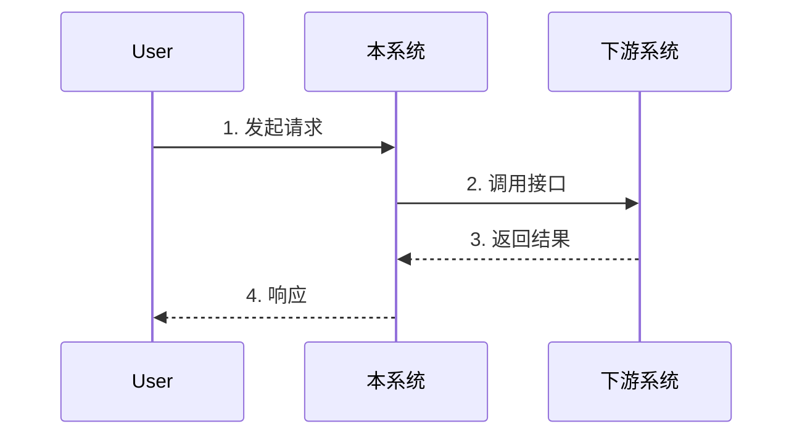

# Prd XQY — 需求规格说明书（XQY 8 章模板）

> 单一职责：以"需规模板.docx"为唯一蓝本，生成企业/金融级需求规格说明书。
> 不做：C 端通用 PRD（→ `prd-standard`）、Spec-First 四件套（→ `prd-spec-first`）、线框图（→ `prd-proto`）、LLM PRD（→ `@ai-product-architect`）。
> 模板源：`commands/product/需规模板.docx`

## 黄金原则

```
1. 章节锁定：8 章标题与编号严格对齐原模板，不增不减不重排
2. 三类分组：3.3 节下严格按 接口 / 菜单功能 / 批处理 分组
3. 表格优先：5 张强制表格列定义不可变更
4. 研发可实现：业务规则写到能直接编码的颗粒度
5. 缺信息显式：未知项用 [待补充：xxx]，禁止编造
6. 批处理三件套：执行时间 + 执行频率 + IP:Port，缺一退回追问
7. 变更可追溯：所有变更同时更新 §8 表格 + 封面修订历史
```

## 完整模板（封面 + 8 章）

```markdown
================================================================
                    需求规格说明书
                    XQY-<需求名称>

                       YYYY 年 M 月
================================================================

【保密声明】
本文件包含保密内容，并具有著作权。未经 XXX 书面同意，任何一方都不得复制或通过任何方式传播，
无论是电子格式、纸张格式、影印格式或其他任何格式，也不得存储在任何性质的检索系统中。

【说明】类型－创建（C）、修改（U）、删除（D）、增加（A）

| 主题     | XXX | XXX | XXX | XXX | XXX |
|----------|-----|-----|-----|-----|-----|
| 说明     | 本文档是"XXX"设计、开发、测试及其系统验收测试的标准 |||||
| 适用对象 | 项目经理、项目组成员 |||||

【修订历史】

| 版本 | 章节 | 类型 | 日期 | 作者 | 说明 |
|------|------|------|------|------|------|
| V1.0 | 1-5  | C    | YYYY/M/D | XXX | 文档创建 |

================================================================
                          目  录
================================================================

第 1 章 概述                                              3
  1.1 业务背景                                            3
  1.2 业务目标                                            3
  1.3 业务需求概述                                        3
  1.4 业务需求提出依据                                    3
  1.5 涉及信息系统                                        3
第 2 章 业务流程                                          4
  2.1 业务流程及说明                                      4
第 3 章 XXX 系统                                          5
  3.1 功能概述                                            5
  3.2 菜单索引                                            5
  3.3 功能说明                                            5
    3.3.1 XXX 接口                                        5
    3.3.2 XXX 菜单功能                                    6
    3.3.3 XXX 批处理                                      6
第 4 章 附件                                              7
第 5 章 历史数据                                          7
第 6 章 测试需求                                          7
第 7 章 非功能需求                                        7
第 8 章 变更及明确需求                                    7

================================================================

# 第 1 章 概述

## 1.1 业务背景
[当前问题 / 业务驱动力 / 监管 / 历史遗留 / 数据支撑]

## 1.2 业务目标
[必须量化：从 X 到 Y / 时间窗口 / 衡量方式]

## 1.3 业务需求概述
[3-5 句话总览本期需求范围]

## 1.4 业务需求提出依据
[监管文号 / 内部决策文件 / 上线缺陷单 / 用户反馈编号]

## 1.5 涉及信息系统
| 系统名称 | 角色 | 交互方向 | 说明 |
|---|---|---|---|
| 本系统 XXX | 实现方 | - | - |
| 上游 A | 调用方 | A → 本系统 | xxx |
| 下游 B | 被调用 | 本系统 → B | xxx |

---

# 第 2 章 业务流程

## 2.1 业务流程及说明

[Mermaid 主流程图，含参与方泳道]



| 步骤 | 操作角色 | 动作 | 输入 | 输出 | 异常处理 |
|---|---|---|---|---|---|
| 1 | 用户 | 提交申请 | 表单数据 | 申请单号 | 字段校验失败提示 |
| 2 | 本系统 | 调用下游 | 申请单号 | 处理结果 | 超时重试 3 次 |

---

# 第 3 章 XXX 系统

## 3.1 功能概述
[本期对该系统的整体改动说明]

## 3.2 菜单索引

| 序号 | 一级菜单 | 二级菜单 | 三级菜单 | 四级菜单 | 权限 | 备注 |
|---|---|---|---|---|---|---|
| 1 | XX | XX |  |  | 角色 A / B | 新增 / 修改 / 删除 |

> 若本期无菜单变更，保留表头并标注"本期无菜单变更"。

## 3.3 功能说明

### 3.3.1 XXX 接口

#### 3.3.1.1 功能描述
[接口用途 / 谁调用 / 何时触发 / 关键约束]

#### 3.3.1.2 接口权限配置

**接口清单**

| 序号 | 接口编码 | 接口名称 | 调用方编码 | 调用方名称 | 备注 |
|---|---|---|---|---|---|
| 1 | IF-XXX-001 | xxx | CALLER-001 | 手机银行 | - |

**请求报文**

| 字段名 | 类型 | 长度 | 必填 | 业务含义 | 校验规则 |
|---|---|---|---|---|---|
| customerNo | String | 20 | Y | 客户号 | 数字，唯一 |
| amount | Decimal | 15,2 | Y | 金额 | > 0 |

**业务逻辑**
1. 校验请求报文必填项
2. 查询客户基本信息
3. 执行业务规则计算
4. 写入交易流水
5. 返回结果

**返回报文**

| 字段名 | 类型 | 长度 | 必填 | 业务含义 |
|---|---|---|---|---|
| respCode | String | 6 | Y | 响应码 |
| respMsg | String | 200 | Y | 响应信息 |
| data | Object | - | N | 业务数据 |

**错误码表**

| 错误码 | 错误描述 | 处理建议 |
|---|---|---|
| 000000 | 成功 | - |
| 100001 | 客户不存在 | 检查客户号 |
| 100002 | 金额超限 | 调整金额 |

#### 3.3.1.3 业务规则
[校验 / 计算 / 状态变更 / 并发约束 / 幂等性]

#### 3.3.1.4 操作权限
保持不变 / [新增角色描述]

#### 3.3.1.5 输入页面、输入项说明
无

#### 3.3.1.6 输出结果
无

---

### 3.3.2 XXX 菜单功能

#### 3.3.2.1 功能描述
[功能用途 / 使用角色 / 入口位置]

#### 3.3.2.2 业务规则
**主要按钮的业务逻辑**：
- **新增**：[校验 → 落库 → 提示]
- **保存**：[校验 → 更新 → 提示]
- **提交**：[校验 → 触发审批流 → 状态变更]
- **驳回**：[填驳回原因 → 状态回退 → 通知申请人]

#### 3.3.2.3 操作权限
保持不变 / [新增角色矩阵]

| 角色 | 查看 | 新增 | 修改 | 删除 | 提交 | 审批 |
|---|---|---|---|---|---|---|
| 操作员 | √ | √ | √ | × | √ | × |
| 复核员 | √ | × | × | × | × | √ |

#### 3.3.2.4 输入页面、输入项说明

**原型**（ASCII 线框图或附件引用）

```
┌──────────────────────────────────────┐
│ 标题区：XXX 维护                      │
├──────────────────────────────────────┤
│ 查询条件： [输入框] [日期]  [查询]    │
├──────────────────────────────────────┤
│ 结果列表：                            │
│ ┌────┬────┬────┬────┐                │
│ │ 列1│ 列2│ 列3│ 操作│                │
│ └────┴────┴────┴────┘                │
├──────────────────────────────────────┤
│ [新增] [导出]                         │
└──────────────────────────────────────┘
```

**字段说明**

| 区域/表单 | 字段/功能名称 | 是否必填 | 是否支持修改 | 选项类型 | 其他规则 |
|---|---|---|---|---|---|
| 查询区 | 客户号 | N | Y | 文字 | 数字，长度 20 |
| 查询区 | 日期范围 | N | Y | 日期 | 不超过 90 天 |
| 列表 | 操作-编辑 | - | - | 按钮 | 仅操作员可见 |

#### 3.3.2.5 输出结果
- 成功：提示"操作成功"，刷新列表
- 失败：弹出错误提示，保留表单内容
- 审计：写入操作日志表（操作人/时间/对象/动作）

---

### 3.3.3 XXX 批处理

#### 3.3.3.1 功能描述
[批处理用途 / 触发条件 / 影响范围]

#### 3.3.3.2 业务规则

**三件套（强制）**：
- **批处理执行时间**：07:00
- **批处理执行频率**：每天一次 / 每周一次 / 月末
- **批处理执行 IP 及 Port**：以开发设计为准 / xxx.xxx.xxx.xxx:port

**批处理逻辑**：
1. 数据准备：从 A 表读取昨日新增数据
2. 数据处理：按业务规则计算 / 汇总 / 过滤
3. 结果落地：写入 B 表 / 推送下游 / 生成报表
4. 异常处理：失败重试 N 次 / 告警通知 / 人工介入
5. 日志：记录执行开始 / 结束时间 / 处理记录数 / 异常明细

#### 3.3.3.3 操作权限
[运维角色 / 业务管理员可手工触发]

#### 3.3.3.4 输入页面、输入项说明
无

#### 3.3.3.5 输出结果
- 日志位置：/var/log/xxx/batch-YYYYMMDD.log
- 报表落地：xxx 报表系统 / FTP 路径
- 下游推送：xxx 系统接口

---

# 第 4 章 附件

[引用的接口文档 / 监管文件 / 数据字典 / 业务规则手册]

无 / [附件列表]

---

# 第 5 章 历史数据

[是否需要数据迁移 / 历史数据兼容方案 / 切换策略]

无 / [迁移方案描述]

---

# 第 6 章 测试需求

[描述测试验证需求]

- 测试范围：[模块清单]
- 测试数据要求：[脱敏 / 量级 / 覆盖场景]
- 验证标准：[功能验收 + 性能验收 + 安全验收]
- 关键测试用例：
  | 用例号 | 场景 | 预期 |
  |---|---|---|
  | TC-001 | 主流程正常 | 返回 000000 |
  | TC-002 | 字段非法 | 返回 100001 |

---

# 第 7 章 非功能需求

| 维度 | 指标 | 目标值 |
|---|---|---|
| 性能 | 单笔接口响应时间 | ≤ 500ms (P99) |
| 性能 | 系统 TPS | ≥ 500 |
| 可用性 | 7×24 可用率 | ≥ 99.95% |
| 安全 | 敏感字段加密 | AES-256 |
| 合规 | 操作审计 | 全量留痕，保留 5 年 |
| 兼容性 | 浏览器 | Chrome 90+ / Edge 90+ |

---

# 第 8 章 变更及明确需求

| 变更序号 | 变更时间 | 变更描述 |
|---|---|---|
| 1 | YYYY-MM-DD | 文档创建 |
| 2 |  |  |
| 3 |  |  |
| 4 |  |  |
| 5 |  |  |
```

## 强制表格速查

| # | 表格名称 | 所在位置 | 列定义 |
|---|---|---|---|
| 1 | 主题/适用对象 | 封面 | 主题 / XXX 5 列 |
| 2 | 修订历史 | 封面 | 版本 / 章节 / 类型 / 日期 / 作者 / 说明 |
| 3 | 菜单索引 | §3.2 | 序号 / 一级 / 二级 / 三级 / 四级 / 权限 / 备注 |
| 4 | 接口清单 | §3.3.x 接口 | 序号 / 接口编码 / 接口名称 / 调用方编码 / 调用方名称 / 备注 |
| 5 | 字段说明 | §3.3.x 菜单 | 区域/表单 / 字段名称 / 是否必填 / 是否可改 / 选项类型 / 其他规则 |
| 6 | 变更明细 | §8 | 变更序号 / 变更时间 / 变更描述 |

## 三类功能编排规则

```
功能识别决策树：

是否对外提供数据/服务？
  ├─ 是 → 接口类（按 §3.3.x 接口 6 小节）
  └─ 否 ↓
       有图形界面操作？
         ├─ 是 → 菜单类（按 §3.3.x 菜单 5 小节）
         └─ 否 ↓
              定时/批量执行？
                └─ 是 → 批处理类（按 §3.3.x 批处理 5 小节）
```

混合类需求：在同一个 §3.3 节下，按 3.3.1 / 3.3.2 / 3.3.3 分别展开，**不要混写**。

## 业务规则写法（接口节关键）

```
❌ 系统应该校验客户号合法性
✅ 调用 /api/customer/check?customerNo=xxx 校验客户号：
   - 长度必须 = 20 位
   - 必须为数字
   - 必须在客户主表存在且 status = 'ACTIVE'
   - 校验失败返回 100001，业务终止

❌ 处理转账业务
✅ 1. 锁定转出账户（select for update）
   2. 校验余额 >= 转账金额 + 手续费
   3. 转出账户 - 金额，转入账户 + 金额
   4. 写交易流水（同一事务）
   5. 提交事务
   6. 异步推送报文给清算系统
   异常：余额不足返回 200001；并发冲突返回 200002，建议重试
```

## 自检 checklist

输出前过一遍：

```
□ 封面 5 项齐全（标题 / 编号 / 日期 / 主题表 / 修订历史 / 保密声明）
□ 目录页章节号 = 正文章节号
□ 1.1-1.5 五个子节都有内容（缺则 [待补充：xxx]）
□ 第 2 章有流程图 + 步骤说明表
□ 3.2 菜单索引表格存在（即使本期无变更）
□ 3.3 下严格按 接口 / 菜单 / 批处理 分组
□ 每个接口节有 6 小节：功能描述 / 接口权限配置（请求/逻辑/返回/错误码）/ 业务规则 / 操作权限 / 输入页面 / 输出结果
□ 每个菜单节有 5 小节，并含字段说明表
□ 每个批处理节有三件套（时间 + 频率 + IP:Port）+ 批处理逻辑
□ 第 4-7 章存在（无内容写"无"）
□ 第 8 章变更表至少 1 行（V1.0 写"文档创建"）
□ 全文未编造监管文号 / 接口编码 / 性能数字（用 [待补充]）
```

## 与其他 PRD 模式的边界

| 场景 | 推荐 |
|------|------|
| 1 页内对齐方向 | `prd-lite` |
| C 端通用 8 章 PRD | `prd-standard` |
| Spec-First 工程化四件套 | `prd-spec-first` |
| 含 ASCII 线框图深化 | `prd-proto` |
| 通用 B 端 SaaS 严格 12 章 | `/pm-prd-enterprise` |
| **银行/金融/企业 XQY 强模板** | **本 Skill（`/prd --mode xqy` + `@xqy-spec-writer`）** |
| 含 LLM/Agent/RAG | `@ai-product-architect` |
| 完成后做质量自检 | `prd-quality-check` |
