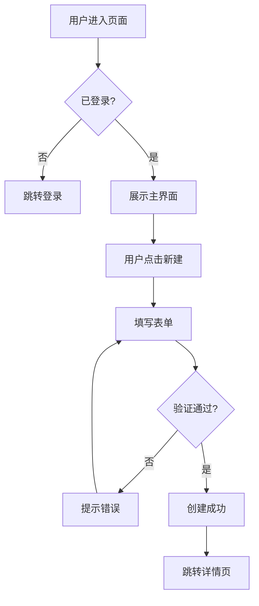

# Product Spec — 产品规格生成知识库

四种模式的完整知识库，统一产品规格生成的方法论和模板。

---

# 一、PRD 写作黄金原则（通用）

```
1. 问题优先：先说清楚要解决什么问题，再说解法
2. 用户视角：每个功能点都能对应到用户需求
3. 可测试：验收标准用 Given/When/Then 写，开发和测试能直接用
4. 刚好够用：精炼而不精简，避免歧义但不过度设计
5. 活文档：PRD 随迭代更新，记录决策变更历史
6. 行业无偏见：消费品/游戏/电商/工业品/服务业与 SaaS 同等适用
```

---

# 二、模式 A — PRD（标准产品需求文档）

## Lite PRD 模板（一页纸）

```markdown
# [功能名] — 一页纸 PRD

**日期**：YYYY-MM-DD | **作者**：[PM 姓名] | **状态**：草稿/评审中/已批准

## 背景与问题
[1-2句话说明背景，附关键数据支撑]
当前问题：[具体描述，附用户反馈或数据]

## 目标用户
[用户角色] 在 [场景] 下，需要 [需求]，但目前 [障碍]。

## 解决方案
[一句话描述方案]
核心功能（MVP）：
1. [功能 1]
2. [功能 2]
3. [功能 3]

## 成功指标
- 主指标：[指标名] 从 X% 提升到 Y%（[时间范围]内）
- 护栏指标：[不能变差的指标]

## 不在范围
- [排除项 1]
- [排除项 2]
```

## Full PRD 模板

```markdown
# [产品/功能名] PRD

**版本**：v1.0 | **状态**：[草稿/评审/已批准/已交付]
**PM**：[姓名] | **工程师**：[姓名] | **设计师**：[姓名]
**创建日期**：YYYY-MM-DD | **目标发布日**：YYYY-MM-DD

---

## 1. 概述

### 1.1 问题陈述
[描述用户痛点或业务机会，附数据]

### 1.2 解决方案摘要
[2-3 句话说明方案核心思路]

### 1.3 成功标准
| 指标 | 当前值 | 目标值 | 时间范围 |
|------|--------|--------|---------|
| [指标 1] | X | Y | 30天 |

---

## 2. 用户与场景

### 2.1 目标用户
**主要用户**：[画像描述]
**次要用户**：[画像描述]

### 2.2 使用场景
**场景 A（核心）**：
> [用户] 在 [时间/地点] 需要 [做某事]，因为 [原因]。

### 2.3 用户旅程（关键路径）
[步骤 1] → [步骤 2] → [步骤 3] → [Aha Moment]

---

## 3. 功能规格

### 3.1 功能 1：[名称]

**用户故事**：
As a [用户角色], I want to [行为], so that [目的].

**验收标准**：
- Given [前置条件], When [用户操作], Then [系统响应]
- Given [异常条件], When [用户操作], Then [错误处理]

**边界条件**：
- [限制/约束 1]
- [限制/约束 2]

---

## 4. 非功能需求
- **性能**：[响应时间要求]
- **安全**：[数据处理要求]
- **兼容性**：[浏览器/设备/OS]
- **可访问性**：[WCAG 级别]

---

## 5. 指标体系
- **北极星指标**：[指标名]
- **核心指标**：[指标 1]、[指标 2]
- **护栏指标**：[不能恶化的指标]
- **埋点需求**：[关键事件列表]

---

## 6. 发布计划
| 阶段 | 范围 | 时间 | 负责人 |
|------|------|------|--------|
| Alpha | 内测（10人） | W1-W2 | PM |
| Beta | 灰度（10%） | W3 | Eng |
| GA | 全量 | W4 | PM |

---

## 7. 风险与依赖
| 风险 | 概率 | 影响 | 缓解措施 |
|------|------|------|---------|
| [风险 1] | 高/中/低 | 高/中/低 | [缓解方案] |

---

## 8. 变更记录
| 日期 | 版本 | 变更内容 | 原因 |
|------|------|---------|------|
```

## GTM 计划模板（`--mode prd --prd-mode gtm`）

```markdown
# [产品/功能] GTM 计划

## 上线目标
- 商业目标：[目标]
- 成功指标：[指标]

## 目标客户细分
- 主要受众：[描述]
- 次要受众：[描述]

## 核心价值主张
[一句话：我们帮助 [用户] 解决 [问题]，通过 [方法]，不像 [竞品] 那样 [区别]。]

## 上线策略
| 渠道 | 内容 | 时间 | 负责人 |
|------|------|------|--------|
| 官网博客 | 功能介绍文章 | T-3天 | Content |
| Email | 现有用户通知 | T-1天 | Growth |
| 社交媒体 | 发布贴 | T+0 | Marketing |
| 产品内 | 弹窗/引导 | T+0 | PM |

## 定价策略
[描述定价逻辑，如有调整]

## 风险预案
- 如果 [风险]，则 [预案]
```

## 用户旅程 + Mermaid 流程图（`--mode prd --prd-mode workflow`）



---

# 三、模式 B — Spec（Spec-First 规格工作流）

> 核心理念：**AI 写代码之前，先让人与 AI 对齐规格**（灵感来源：OpenSpec）

```
一句话想法
    ↓
proposal.md ── 为什么做？改什么？不做什么？        [立项对齐]
    ↓
specs/      ── 具体要发生什么？（用户视角）          [研发交付]
    ↓
design.md   ── 长什么样？怎么交互？（UI 视角）       [设计对接]
    ↓
tasks.md    ── 谁来做？做什么？先做什么？（研发视角） [Sprint 规划]
```

## Proposal 模板

```markdown
# [功能名] — 提案

**日期**：YYYY-MM-DD
**提案人**：[姓名]
**状态**：草稿 / 讨论中 / 已批准 / 已拒绝

---

## 背景与问题

[1-3句话描述现状和问题，必须附关键数据]

**关键数据**：
- [数据点 1，如：当前新用户 7 日留存率仅 18%]（来源：[数据来源]）

**用户反馈**：
> "[典型用户反馈原话]" — [渠道：用户访谈/工单/NPS 评论]

---

## 我们要做什么

[一句话描述解决方案]

**核心改变**：
1. [改变 1]
2. [改变 2]
3. [改变 3]

---

## 成功标准

| 指标 | 当前值 | 目标值 | 时间范围 | 类型 |
|------|--------|--------|---------|------|
| [主指标] | — | — | 发布后 30 天 | 提升 |
| [护栏指标] | — | ≥ 当前值 | 持续监控 | 不退化 |

---

## 不在范围（明确不做）

- **[排除项 1]**：原因：[简短说明]
- **[排除项 2]**：原因：[简短说明]

---

## 开放问题

- [ ] [待决策问题 1]（截止：[日期]，决策人：[姓名]）
- [ ] [待决策问题 2]

---

## 变更历史

| 日期 | 版本 | 变更内容 | 作者 |
|------|------|---------|------|
| YYYY-MM-DD | v1.0 | 初始版本 | [姓名] |
```

## Specs 模板（功能规格）

```markdown
# [功能名] — 功能规格

**关联提案**：proposal.md
**版本**：v1.0 | **状态**：草稿 / 评审中 / 已确认
**PM**：[姓名] | **确认日期**：YYYY-MM-DD

---

## 用户角色定义

| 角色 | 描述 | 典型场景 |
|------|------|---------|
| [角色 1] | [描述] | [核心使用场景] |
| [角色 2] | [描述] | [核心使用场景] |

---

## 用户故事

### US-01：[故事名称]

**As a** [用户角色],
**I want to** [行为/目标],
**So that** [价值/原因].

**优先级**：P0 / P1 / P2
**估时**：[工程师工作量，如 3天]

#### 验收标准

| # | Given（前置条件） | When（触发操作） | Then（期望结果） |
|---|-----------------|----------------|----------------|
| AC-01 | [正常条件] | [用户操作] | [系统响应] |
| AC-02（异常）| [异常条件] | [用户操作] | [错误处理方式] |
| AC-03（边界）| [边界条件] | [用户操作] | [边界处理方式] |

#### 边界条件

- **最大限制**：[如输入框最多 200 字符]
- **并发处理**：[如同时多人编辑时的锁定机制]
- **空状态**：[列表为空时的展示策略]
- **权限限制**：[不同角色的访问/操作权限差异]
- **网络异常**：[断网/超时的降级处理]

---

## 数据模型

| 字段名 | 类型 | 必填 | 验证规则 | 说明 |
|--------|------|------|---------|------|
| [字段] | String / Int / Boolean | 是/否 | [规则，如最长50字] | [说明] |

---

## 非功能需求

- **性能**：[如接口 P95 响应时间 < 500ms，列表加载 < 2s]
- **安全**：[如敏感字段脱敏展示，操作需二次确认]
- **兼容性**：[如 Chrome 90+, Safari 14+, 移动端 iOS 15+]
- **可访问性**：[WCAG 2.1 AA 级，支持键盘导航]
```

## Tasks 模板（实施清单）

```markdown
# [功能名] — 实施任务清单

**Sprint**：[编号]
**目标发布日**：YYYY-MM-DD
**关联文档**：[proposal.md] | [specs/] | [design.md]

---

## P0 核心任务（阻塞发布）

### 🔧 后端

- [ ] **[任务名]**（预估：[N 天]，负责人：[工程师]）
  - [ ] 设计数据库表结构
  - [ ] 实现 CRUD 接口
  - [ ] 编写单元测试（覆盖率 ≥ 80%）
  - 依赖：[依赖项]

### 🎨 前端

- [ ] **[任务名]**（预估：[N 天]，负责人：[工程师]）
  - [ ] 实现页面组件（默认态/空态/加载态/错误态）
  - [ ] 对接后端接口
  - [ ] 响应式适配（移动端/桌面端）
  - [ ] 埋点接入（见下方埋点需求）

### 🧪 测试

- [ ] **编写测试用例**（预估：[N 天]，负责人：[QA]）
  - [ ] 覆盖所有验收标准（AC-01 至 AC-XX）
  - [ ] 边界条件测试
  - [ ] 性能测试（接口响应 / 页面加载）

---

## P1 优化任务（重要但非阻塞）

- [ ] [任务]（预估：[N 天]，说明：[为什么是 P1]）

---

## P2 后续迭代（本期不做）

- [ ] [功能点]（延后原因：[说明]，预计时间：[时间]）

---

## 埋点需求

| 事件名 | 触发时机 | 参数 |
|--------|---------|------|
| [event_name] | [用户操作/页面加载] | { [key]: [value], ... } |

---

## 发布检查清单

- [ ] 所有 P0 任务已完成
- [ ] 所有验收标准已通过测试
- [ ] 埋点数据已验证（测试环境抓包确认）
- [ ] 性能指标达标（P95 接口 < 500ms，页面 LCP < 2.5s）
- [ ] 灰度方案已确认（建议先 10% → 50% → 100%）
- [ ] 回滚方案已确认（Feature Flag / 版本回退流程）
- [ ] 监控告警已配置（错误率 / 成功率 / 响应时间）
- [ ] 上线文案已准备（Changelog / 用户通知）
```

## Spec 阶段质量门控

```
Proposal → Specs 入场条件：
✅ 问题描述有数据/用户反馈支撑
✅ 成功标准可量化（有具体数值）
✅ 排除项已明确（写出"不做什么"）
✅ 关键假设和开放问题已识别

Specs → Design 入场条件：
✅ 所有主路径（P0 用户故事）有完整验收标准
✅ 异常场景和边界条件已覆盖
✅ 数据模型和字段约束已定义
✅ 权限边界已明确

Design → Tasks 入场条件：
✅ 所有关键页面状态已绘制（默认/空/加载/错误）
✅ 核心交互流程有 Mermaid 流程图
✅ 文案已定稿（无[待定]/[TBD]占位）
✅ 组件规格和交互细节已说明

Tasks → 研发启动 入场条件：
✅ 所有 P0 任务有明确负责人
✅ 任务依赖关系已梳理（无循环依赖）
✅ 估时合理（未超出 Sprint 容量）
✅ 发布检查清单已确认完整
```

---

# 四、模式 C — Proto（线框图 + PRD 融合）

## 核心理念

```
线框图 回答："长什么样？用户怎么操作？"
PRD    回答："为什么这样做？做到什么程度？怎么验收？"

融合工作流：线框图让 PRD 功能规格更具体；PRD 让线框图设计决策有依据。
```

## 线框图必须覆盖的状态

```
✅ 必须覆盖（每个核心页面）
  1. 默认态   — 有正常数据时的展示
  2. 空态     — 无数据/首次使用时的引导
  3. 加载态   — 数据请求中（骨架屏）
  4. 错误态   — 接口失败/网络异常

✅ 推荐覆盖
  5. 操作反馈态 — 表单提交成功/失败后
  6. 禁用态     — 权限不足/功能不可用时
  7. 移动端     — 如有响应式需求
```

## ASCII 线框图标注规范

```
元素符号：
┌─┐ └─┘ ─── │    容器/卡片/模块边框
[按钮文字]   可点击按钮
{输入内容}   文本输入框（单行）
{多行文本  } 多行文本输入区域
[x] 复选框  Checkbox
(○) 单选框  Radio Button
[下拉▼]    下拉选择器
░░░░░       骨架屏/加载占位
[图片区域]  图片/头像/封面区域

交互标注（写在线框图下方）：
→ [元素] 点击：[发生什么]
→ [元素] 条件显示：[当...时才展示]
→ [字段] 数据来源：[接口/字段名]
→ [文案] 字数上限：[N 字/N 行]
→ [操作] 权限要求：[仅...角色可见]
```

## 标准线框图模板库

### 列表页（带搜索筛选）

```
┌─────────────────────────────────────────────────┐
│  [← 返回]  页面标题            [搜索🔍] [筛选▼]  │
├─────────────────────────────────────────────────┤
│  [全部] [类型A] [类型B] [状态:全部▼]             │
│  排序：[最近更新▼]                    共 N 条     │
│  ─────────────────────────────────────────────  │
│  ☐ [记录标题（最多2行截断）          ] [状态] [⋮] │
│    副标题/摘要 · 2024-01-01 · 创建人             │
│  ─────────────────────────────────────────────  │
│                    [◀] [1] [2] [3] [...] [▶]   │
└─────────────────────────────────────────────────┘
→ [⋮] 点击：展示下拉菜单（编辑/删除/更多操作）
→ [☐] 点击：多选模式，顶部出现批量操作栏
```

### 创建/编辑弹窗

```
┌────────────────────────────────┐
│  创建[对象名]             [×]  │
│  ─────────────────────────    │
│  名称 *                        │
│  {请输入名称（最多50字）    }   │
│                                │
│  描述                          │
│  {请输入描述...             }  │
│  {                     0/200}  │
│                                │
│  类型 *                        │
│  (○) 选项 A  (○) 选项 B       │
│                                │
│  ─────────────────────────    │
│  [取消]              [创建 →]  │
└────────────────────────────────┘
→ [创建 →]：前端验证 → 提交API → Loading → 成功/失败
→ 成功：关闭弹窗 + Toast"创建成功" + 列表刷新
→ 失败：Toast 错误信息 + 保持弹窗打开
```

### 详情页

```
┌─────────────────────────────────────────────────┐
│  [← 返回列表]                                   │
│  [对象标题                          ]  [编辑]   │
│  状态：[已完成 ✓]  创建：2024-01-01 · [创建人]  │
│  ─────────────────────────────────────────────  │
│  基本信息                                        │
│  ┌─────────────────────────────────────────┐    │
│  │  字段 1    │  [值]                       │    │
│  │  字段 2    │  [值]                       │    │
│  └─────────────────────────────────────────┘    │
│  关联内容                         [+ 添加]      │
│  操作历史                         [展开全部 ▼]  │
└─────────────────────────────────────────────────┘
```

### 空态设计规范

```
┌─────────────────────────────────────────────────┐
│              [🎯 主题图标或插图]                  │
│         还没有任何[对象中文名]                   │
│    [对象名]可以帮助你[核心使用价值，15字内]       │
│           [+ 创建第一个[对象名]]                 │
│  💡 小技巧：[与场景相关的使用建议，20字内]        │
└─────────────────────────────────────────────────┘
文案原则：积极、引导性（"开始"/"创建"/"探索"）
```

## 线框图元素 → PRD 内容映射

```
线框图元素              PRD 对应内容
──────────────────────────────────────────────
页面/弹窗标题     →  功能模块名称
输入字段 *        →  必填字段 + 字数/格式验证规则
下拉选项          →  枚举值定义 + 允许值范围
按钮              →  用户操作（When）+ 系统响应（Then）
状态标签          →  状态流转定义 + 各状态含义
列表展示字段      →  数据字段 + 排序规则 + 截断规则
空态              →  空状态定义 + 引导策略 + 引导文案
错误提示位置      →  错误类型分类 + 每类错误的展示文案
分页              →  分页规格（每页N条/总数/翻页逻辑）
加载骨架屏        →  最大等待时间 + 超时处理
```

## 保真度提升路径

```
阶段 1：低保真（分钟级）— ASCII 草图，验证信息架构和页面流程
阶段 2：中保真（小时级）— ASCII 精细图，含所有状态/文案/组件标注（默认产出）
阶段 3：高保真（天级）  — Penpot / Figma 像素级设计稿
阶段 4：代码原型（周级）— Next.js + Framer Motion 真实交互
```

---

# 五、PRD 质量自检清单

> 来源：prd-mcp-server（https://github.com/saml1211/prd-mcp-server）

## 评分维度

| 维度 | 权重 | 检查项 |
|------|------|--------|
| 完整性 | 30% | 包含背景/目标/用户/功能/指标/风险六要素 |
| 可测性 | 25% | 验收标准使用 Given/When/Then 格式 |
| 可量化 | 20% | 成功指标有具体数值，非模糊描述 |
| 边界明确 | 15% | 有"不在范围"章节，排除项有理由 |
| 数据支撑 | 10% | 背景描述有数据来源，非主观判断 |

**评分标准**：优秀（90-100）/ 良好（75-89）/ 待改进（60-74）/ 不合格（< 60）

## 自检清单

```
完整性（30%）
- [ ] 有明确的背景/问题陈述（附数据或用户反馈）
- [ ] 有可量化的成功标准（非模糊描述）
- [ ] 有目标用户画像（至少一个主要角色）
- [ ] 有功能规格（用户故事/验收标准）
- [ ] 有指标体系（北极星/核心/护栏指标）
- [ ] 有风险评估（技术风险/业务风险）

可测性（25%）
- [ ] 验收标准使用 Given/When/Then 格式
- [ ] 每个用户故事有至少一个正常路径 AC
- [ ] 每个用户故事有至少一个异常路径 AC
- [ ] 边界条件已覆盖（最大值/空值/并发）

可量化（20%）
- [ ] 成功指标有具体数值（如"从 18% 提升到 30%"）
- [ ] 时间范围明确（如"发布后 30 天内"）
- [ ] 性能需求有数字（如"P95 < 500ms"）

边界明确（15%）
- [ ] 有"不在范围"章节
- [ ] 排除项有说明理由
- [ ] 依赖项和前置条件已识别

数据支撑（10%）
- [ ] 背景描述有数据来源（非主观判断）
- [ ] 竞品对比有具体依据
- [ ] 用户反馈有真实案例
```

## 常见低分问题修复

```
❌ 验收标准："系统应该支持多种登录方式"
✅ 修复：Given 用户在登录页，When 点击"微信登录"，
        Then 弹出微信授权页面，授权成功后自动登录

❌ 成功指标："提升用户满意度"
✅ 修复："NPS 从 32 提升到 45，发布后 60 天内"

❌ 缺少不在范围："本次实现登录功能"
✅ 修复："不在范围：单点登录（SSO）、SAML/LDAP 集成，留待企业版本实现"

❌ 功能描述无边界条件
✅ 补充：最大限制/并发处理/权限限制/网络异常
```

---

# 六、MCP Server 快速集成

```json
// Claude Desktop / Claude Code 配置
{
  "mcpServers": {
    "prd-creator": {
      "command": "npx",
      "args": ["-y", "prd-creator-mcp"]
    }
  }
}
```

集成后可调用：
- `generate_prd` — 基于参数生成结构化 PRD
- `validate_prd` — 验证现有 PRD 质量，返回评分和建议
- `list_validation_rules` — 查看所有验证规则详情
- `create_template` / `render_template` — 管理自定义 PRD 模板

---

# 七、功能决策框架

```
拒绝一个需求的合理理由：
1. 不符合目标用户群
2. 解决的问题不够大（影响 <5% 用户）
3. 与产品定位/策略冲突
4. 技术成本高于用户价值
5. 可用第三方集成代替

接受一个需求的信号：
1. 多个高价值用户提出相同需求
2. 当前痛点导致明显流失
3. 竞品已有且用户明确对比
4. 解锁关键商业场景（企业/合规/集成）
```

---

# 八、企业级 PRD 严格模板（B 端 / SaaS / 私有化）

> 当目标受众包含**企业研发评审、客户技术验收、私有化交付**时，使用更严格的 12 章模板。
> 入口命令：`/pm-prd-enterprise`，模板文件：`templates/prd-template.md`。

## 12 章结构

```
1. 文档信息（含版本号、更新记录）
2. 背景与目标（业务背景 / 当前问题 / 产品目标 / 不做范围）
3. 用户角色与使用场景
4. 需求总览（编号 + 优先级 + 业务价值 + 版本）
5. 业务流程（主流程 / 异常流程 / 状态流转）
6. 功能详细说明（功能说明 / 字段 / 业务规则 / 权限规则 / 异常处理）
7. 数据与接口需求
8. 非功能需求（性能 / 安全 / 审计 / 兼容性 / 可用性 / 可扩展性 / 私有化 / 运维监控）
9. 埋点与数据指标
10. 验收标准
11. 风险与依赖
12. 附录（原型 / 参考 / 竞品 / 客户访谈记录）
```

## 与本知识库其他模式的边界

| 场景 | 推荐模式 |
|------|---------|
| C 端 / 通用产品 / 想法清晰 | 本知识库 `--mode prd`（Lite / Full） |
| C 端 / Spec-First 工程化 | 本知识库 `--mode spec` |
| C 端 / 含线框图 | 本知识库 `--mode proto` |
| **B 端 SaaS / 私有化 / 多租户** | **`/pm-prd-enterprise` + `templates/prd-template.md`** |
| 含 LLM/Agent/RAG | `/ai-feature-spec` |
| 安全 + AI 融合产品 | `pm-ai-security-product` Skill |

## B 端必填项（不可省略）

- **多租户**：数据隔离边界、租户初始化、租户级配置
- **权限**：角色矩阵 × 操作矩阵 × 数据范围矩阵
- **审计**：动作日志、不可篡改、可追溯到人
- **私有化部署**：架构图、运维要求、升级策略
- **客户验收口径**：客户语言写、客户视角验、客户场景跑
- **合规映射**：等保 / SOC2 / GDPR / 个保法（按客户合同）

参考相关 Skills：`compliance-checklist`。
