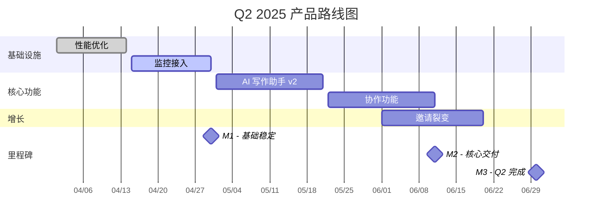

# Product Roadmap — 路线图规划知识库

## 路线图类型选择

```markdown
按受众分类：
1. 对外 Roadmap（客户/投资人）
   → 主题导向，不暴露具体时间
   → 强调"为什么"而非"什么时候"
   → 示例：Now / Next / Later 框架

2. 对内 Roadmap（研发/设计团队）
   → 里程碑 + 时间节点
   → Gantt 图 + Sprint 计划
   → 细化到 Epic/Story 级别

3. 战略 Roadmap（管理层/董事会）
   → OKR 联动，季度粒度
   → 资源分配和财务影响
   → 关键假设和风险
```

## 需求优先级框架

### RICE 评分
```markdown
RICE = (Reach × Impact × Confidence) ÷ Effort

Reach（影响用户数）：每季度/月受影响用户数
Impact（影响程度）：0.25=微小 / 0.5=低 / 1=中 / 2=高 / 3=极高
Confidence（置信度）：100%=高 / 80%=中 / 50%=低
Effort（工作量）：人·周

示例：
功能 A: (500 × 2 × 0.8) ÷ 2 = 400
功能 B: (1000 × 1 × 0.5) ÷ 5 = 100
→ 优先做功能 A
```

### MoSCoW 快速分类
```markdown
Must Have（必须做）：
- 核心流程不可缺少
- 无法上线/合规强制
- 超过 30% 用户依赖

Should Have（应该做）：
- 重要但不紧急
- 有明显价值，延期影响有限

Could Have（可以做）：
- 锦上添花
- 有好处但影响小

Won't Have（暂不做）：
- 这个周期内明确排除
- 避免范围蔓延
```

### ICE 快速评分（轻量）
```markdown
ICE = Impact(1-10) × Confidence(1-10) × Ease(1-10)

适用场景：快速排序大量想法（> 20 个需求时）
局限：不考虑影响用户规模，适合单维度比较
```

## 季度路线图规划流程

```markdown
## T-4周：战略对齐
- 回顾上季度 OKR 完成情况
- 确认下季度核心商业目标
- 识别战略优先级（增长/稳定/基础设施）

## T-3周：需求梳理
- 收集所有需求来源：
  → 用户反馈 (VoC 报告)
  → 数据发现 (指标分析)
  → 竞品动态 (竞品分析)
  → 内部需求 (销售/客服/运营)
  → 技术债务 (工程师提报)
- RICE 评分排序

## T-2周：容量规划
- 确认工程师/设计师有效工时
  → 正常工作时 × 0.7（扣除会议/维护/突发）
  → 预留 20% Buffer（处理突发和优化）
- 识别依赖关系（A 完成才能做 B）
- 识别关键路径

## T-1周：路线图初稿
- 按主题（Theme）组织 Epic
- 里程碑设置（M1/M2/M3）
- Gantt 图绘制
- 跨部门对齐（设计/工程/运营/市场）

## T+0：季度启动
- 全团队路线图 Kickoff
- OKR 绑定确认
- 沟通计划（进度周报/月报/季度复盘）
```

## Gantt 图生成（Mermaid）

```markdown
## 季度 Gantt 模板

```

## GitHub Projects 配置方案

```markdown
## 推荐看板结构

视图 1：产品路线图（按 Milestone）
字段：Title | Status | Priority | Milestone | Assignee | Size

视图 2：Sprint 看板
列：📋 Backlog | 🚀 This Sprint | 🔄 In Progress | 👀 Review | ✅ Done

视图 3：功能追踪（按 Epic）
分组：Epic 主题

## 自定义字段
- Priority: P0/P1/P2/P3
- Size: XS(1d)/S(2-3d)/M(1w)/L(2w)/XL(>2w)
- Type: Feature/Bug/Tech Debt/Spike
- RICE Score: Number
- User Value: 0-10

## MCP 集成（mcp-github-project-manager）
通过 Claude 直接操作 GitHub Projects：
- 创建 Issue 并分配到 Milestone
- 批量更新优先级
- 查询当前 Sprint 状态
- 生成进度报告
```

## OKR 路线图联动

```markdown
## OKR → 路线图映射规则
Objective → 季度主题（Theme）
Key Result → 里程碑（Milestone）
Initiative → Epic
Task → Story/Issue

示例：
O: 提升用户留存率
  KR1: D30 留存从 25% 提升到 35%
    Initiative 1: 新手引导优化（Onboarding）
      Epic: 3步引导流程重设计
      Epic: 空状态优化
    Initiative 2: 邮件召回系统
      Epic: 自动化邮件序列

## OKR 健康检查
- 每个 O 对应不超过 3 个 KR
- KR 必须是可量化的结果，而非行动（Is it a result, not a task?）
- KR 达成率 70% = 健康（100% = 目标设低了）
- 路线图与 KR 的覆盖度 > 80%
```

## 路线图沟通模板

```markdown
## 对外 Roadmap（客户版）

Now（本季度做）
- [功能 A]：[一句话价值描述]
- [功能 B]：[一句话价值描述]

Next（下季度看）
- [方向 A]
- [方向 B]

Later（长期探索）
- [愿景方向]

注：具体日期视开发进展调整，感谢您的耐心等待 🙏

## 对内变更通知
Subject: [路线图更新] Q2 计划调整

调整内容：
- [功能 X] 从 M2 推迟到 M3（原因：依赖外部 API 延期）
- [功能 Y] 提前到 M2（原因：客户 P0 需求）

影响评估：[说明对 OKR 的影响]
下一步：[会议/文档/确认事项]
```


## 配套模板

- `templates/roadmap-template.md` — Now/Next/Later 填充式模板 + 对外/对内变更通知格式
