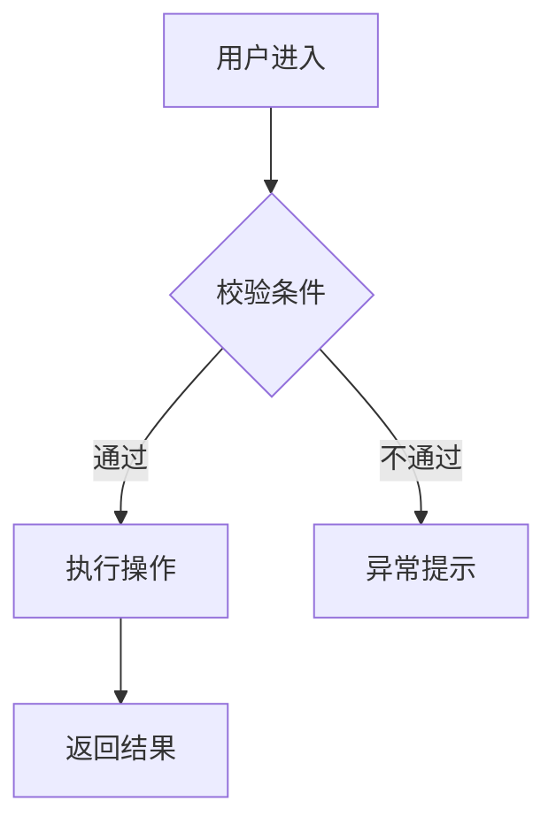
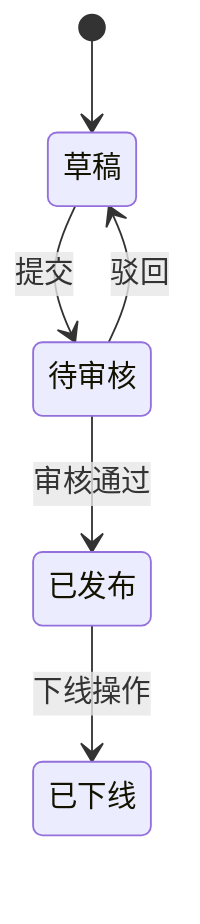

# PRD：{{产品/功能名称}}

> 企业级 PRD 标准模板（融合产品视角 + 工程实现视角）。
> 配套 Agent：`@prd-coach`；配套命令：`/prd-diagnose` → `/prd-concept` → `/prd-impl`（对话渐进），或直接 `/prd-standard`、`/pm-prd-enterprise`。
> 信息不足时用 `[待补充]` 标注，禁止编造。

---

## 1. 文档信息

| 项目 | 内容 |
|---|---|
| 产品名称 | |
| 需求名称 | |
| 功能模块 | |
| 文档版本 | v0.1 |
| 当前状态 | 草稿 / 评审中 / 已确认 / 已发布 |
| 作者 | |
| 创建时间 | |
| 更新时间 | |
| 评审人员 | |
| 相关人员 | 产品 / 设计 / 前端 / 后端 / 测试 / 运维 |

### 1.1 版本变更记录

| 版本 | 日期 | 修改人 | 修改内容 |
|---|---|---|---|

---

## 2. 需求背景

### 2.1 当前问题
说明当前业务、产品或用户使用过程中存在的问题。

### 2.2 业务影响
说明该问题对用户体验、业务效率、安全性、管理效率或商业目标的影响。

### 2.3 用户痛点
- 痛点一：
- 痛点二：
- 痛点三：

### 2.4 建设必要性
说明为什么当前阶段需要建设该功能（时机、合规、战略、ROI 等）。

---

## 3. 产品目标

- 目标一：
- 目标二：
- 目标三：

### 3.1 量化指标（可验收）

| 指标 | 现状基线 | 目标值 | 衡量方式 |
|---|---|---|---|

---

## 4. 用户角色与权限

| 角色 | 使用场景 | 核心诉求 | 可操作功能 | 权限范围 | 使用频率 |
|---|---|---|---|---|---|
| 普通用户 | | | | | |
| 管理员 | | | | | |
| 审计/只读角色 | | | | | |

---

## 5. 需求范围

### 5.1 本期实现（MVP）
- 🔴 [核心功能 1]
- 🔴 [核心功能 2]
- 🟡 [重要功能]

### 5.2 本期不实现（含原因）
- [排除项 1]：原因
- [排除项 2]：原因

### 5.3 后续版本规划
- ⚪ V2 考虑：
- ⚪ V3 考虑：

---

## 6. 功能位置与入口

| 项目 | 内容 |
|---|---|
| 一级菜单 | |
| 二级菜单 | |
| 页面名称 | |
| 入口按钮/链接 | |
| 默认展示条件 | |
| 可见角色 | |

---

## 7. 前置条件与依赖关系

### 7.1 前置条件
1. 用户已完成 [XXX]
2. 系统已开启 [XXX] 配置
3. 数据已具备 [XXX]

### 7.2 依赖服务

| 依赖项 | 是否必须 | 失败影响 | 处理方式 |
|---|---|---|---|

---

## 8. 业务流程

### 8.1 主流程（Mermaid 图 + 文字描述）



文字描述：
1. 用户进入 XXX 页面；
2. 用户填写 / 选择 XXX；
3. 系统进行 XXX 校验；
4. 用户点击 XXX；
5. 系统执行 XXX；
6. 系统返回 XXX；
7. 用户完成 XXX。

### 8.2 分支流程

| 场景 | 触发条件 | 系统处理 | 用户提示 |
|---|---|---|---|

### 8.3 异常流程

| 异常场景 | 触发条件 | 系统处理 | 用户提示 | 是否允许重试 |
|---|---|---|---|---|

---

## 9. 功能详细说明

> 每个 🔴 核心功能单独一节，编号 9.1 / 9.2 / 9.3 ...

### 9.1 功能一：{{功能名称}}

**功能说明**：[一句话说明这个功能做什么]
**触发条件**：[什么情况下用户会用到这个功能]
**入口位置**：[菜单路径 / 按钮位置]
**用户操作**：[用户的操作步骤]
**系统规则**：[业务规则与处理逻辑]
**权限要求**：[需要什么角色 / 权限]

#### 9.1.1 交互细节
- 操作反馈：[用户操作后立即看到什么]
- 破坏性操作确认：[删除/覆盖等操作的二次确认文案]
- 空态引导：[没有数据时展示什么]
- 失败引导：[出错时给用户什么操作选择]

#### 9.1.2 状态清单

| 状态 | 触发条件 | 展示内容 |
|---|---|---|
| 默认态 | 正常有数据时 | |
| 加载中 | 请求进行中 | 骨架屏 / Loading |
| 成功 | 操作完成 | Toast / 跳转 / 刷新 |
| 失败 | 接口错误 / 权限不足 | 错误提示 + 操作建议 |
| 禁用 | 无权限 / 条件未满足 | 灰态 + 说明文案 |
| 空态 | 无数据 | 空态插图 + 引导操作 |

#### 9.1.3 边界条件

| 边界类型 | 处理方式 |
|---|---|
| 空内容输入 | |
| 内容溢出（如 >200 字符） | |
| 网络异常 | |
| 无权限 | |
| 并发冲突 | |
| 格式不匹配 | |

#### 9.1.4 验收标准
- [ ] 验收项 1：
- [ ] 验收项 2：
- [ ] 验收项 3：

### 9.2 功能二：{{功能名称}}

（同上结构）

---

## 10. 页面与交互说明

### 10.1 页面一：{{页面名称}}

| 项目 | 内容 |
|---|---|
| 页面入口 | |
| 页面用途 | |
| 默认状态 | |
| 可见角色 | |

**页面元素**：
- 标题区：
- 内容区：
- 操作区：

**关键页面线框图（ASCII）**：
```
┌──────────────────────────────────┐
│ [Logo]    导航    用户头像        │
├──────────────────────────────────┤
│ 标题                              │
│ ┌────────┐  ┌────────────────┐  │
│ │ 筛选区 │  │  数据展示区     │  │
│ │        │  │                 │  │
│ └────────┘  └────────────────┘  │
│                       [主操作]   │
└──────────────────────────────────┘
```

**用户操作**：
**系统反馈**：
**异常提示**：

### 10.2 页面二：{{页面名称}}

（同上结构）

---

## 11. 字段说明

| 字段名称 | 控件类型 | 类型 | 长度/范围 | 是否必填 | 默认值 | 输入规则 | 占位符 | 校验失败提示 |
|---|---|---|---|---|---|---|---|---|

---

## 12. 按钮与操作状态

| 页面模式 | 表单状态 | 可见按钮 | 可点击条件 | 说明 |
|---|---|---|---|---|
| 查看模式 | 只读 | | | |
| 编辑模式 | 可编辑 | | | |
| 加载中 | 不可编辑 | | | |
| 无权限 | 只读 / 隐藏 | | | |

---

## 13. 状态流转



| 当前状态 | 触发动作 | 下一个状态 | 操作人 | 说明 |
|---|---|---|---|---|

---

## 14. 校验规则

| 校验对象 | 校验规则 | 失败提示 |
|---|---|---|
| 必填字段 | 不允许为空 | 请输入 XXX |
| 格式字段 | 需符合指定格式 | XXX 格式不正确 |
| 枚举字段 | 只能选择指定选项 | 请选择 XXX |
| 长度限制 | 不超过 N 字符 | XXX 不能超过 N 个字符 |
| 唯一性 | 不允许重复 | XXX 已存在 |
| 权限校验 | 当前用户需具备权限 | 当前账号无权限操作 |

---

## 15. 文案规范

### 15.1 整体语气
[专业 / 友好 / 简洁 / 活泼] — [一句话描述产品的说话方式]

### 15.2 通用提示文案

| 场景 | 提示类型 | 文案示例 | 备注 |
|---|---|---|---|
| 操作成功 | Toast | XXX 成功 | 简短，说明完成了什么 |
| 操作失败 | Toast | XXX 失败，请稍后重试 | 说明问题 + 建议操作 |
| 字段为空 | 表单提示 | 请输入 XXX | |
| 格式错误 | 表单提示 | XXX 格式不正确 | |
| 权限不足 | 页面提示 | 当前账号无权限访问该功能 | |
| 删除确认 | 弹窗 | 确认删除？此操作不可撤销 | 明确说明不可撤销 |
| 加载中 | Loading | 正在处理... | |
| 空态标题 | 占位 | 暂无数据 | ≤15 字，积极语气 |

### 15.3 技术说明文案（面向开发 / AI）

| 位置 | 技术说明 |
|---|---|
| 字段 `user_id` | 用户唯一标识，UUID 格式 |
| 接口 `POST /items` | 创建新记录，返回 `item_id` |

---

## 16. 安全与隐私要求

1. 敏感字段需要脱敏展示（手机号、身份证、银行卡等）；
2. 密码、密钥、Token 不得明文展示或日志输出；
3. 关键操作需要权限校验（含越权检测）；
4. 关键操作需要记录审计日志（操作人 / 时间 / IP / 内容）；
5. 临时凭证、验证码、Token 需要设置有效期；
6. 异常失败次数过多时，需要考虑限流、锁定或告警；
7. 数据传输需走 HTTPS / 加密通道；
8. 个人信息收集需符合 GDPR / 个保法等合规要求。

---

## 17. 非功能需求

| 类型 | 要求 |
|---|---|
| 性能 | 接口响应 P95 ≤ 500ms，页面首屏 ≤ 2s |
| 可用性 | 系统可用率 ≥ 99.9% |
| 兼容性 | 支持的浏览器 / 设备 / 系统版本 |
| 安全 | 见第 16 节安全要求 |
| 可观测性 | 关键指标监控 + 告警阈值 |
| 可扩展性 | 支持水平扩展 / 模块化扩展 |
| 私有化部署 | 是否支持 / 部署方式 |
| 运维监控 | 健康检查 / 日志收集 / 告警通道 |

---

## 18. 埋点与统计

| 埋点事件 | 触发时机 | 上报字段 | 统计用途 |
|---|---|---|---|
| 页面访问 | 页面打开 | user_id, page, ts | PV / UV |
| 任务创建 | 创建成功 | task_id, type | 任务创建量 |
| 操作成功 | 接口返回成功 | action, duration | 成功率 / 性能 |
| 操作失败 | 接口返回失败 | action, error_code | 失败率 / 异常分析 |

### 18.1 关键 KPI
- 页面访问量（PV / UV）：
- 任务创建量：
- 成功率（目标 ≥ XX%）：
- 失败率（告警阈值 ≥ XX%）：
- 平均执行时长：

---

## 19. 接口与数据要求

### 19.1 需要的接口

| 接口名称 | 方法 | 路径 | 入参 | 出参 | 权限 | 说明 |
|---|---|---|---|---|---|---|
| 查询接口 | GET | /api/v1/xxx | | | | |
| 新增接口 | POST | /api/v1/xxx | | | | |
| 编辑接口 | PUT | /api/v1/xxx/{id} | | | | |
| 删除接口 | DELETE | /api/v1/xxx/{id} | | | | |
| 状态变更接口 | PATCH | /api/v1/xxx/{id}/status | | | | |
| 测试/校验接口 | POST | /api/v1/xxx/validate | | | | |
| 日志接口 | GET | /api/v1/xxx/logs | | | | |

### 19.2 数据字段（核心数据对象）

| 字段 | 类型 | 长度 | 是否必填 | 默认值 | 说明 |
|---|---|---|---|---|---|
| id | string | 36 | 是 | - | 唯一 ID（UUID） |
| status | enum | - | 是 | draft | 当前状态 |
| created_by | string | 36 | 是 | - | 创建人 |
| created_at | datetime | - | 是 | now | 创建时间 |
| updated_by | string | 36 | 是 | - | 更新人 |
| updated_at | datetime | - | 是 | now | 更新时间 |

---

## 20. 验收标准

### 20.1 功能验收
- [ ] 用户可以在指定入口看到该功能；
- [ ] 有权限用户可以正常操作，无权限用户不可操作；
- [ ] 字段为空、格式错误、权限不足等场景提示正确；
- [ ] 正常流程可以完整走通；
- [ ] 异常流程可以正确拦截和提示；
- [ ] 页面状态、按钮状态、数据状态流转符合预期；

### 20.2 安全与质量验收
- [ ] 敏感信息展示符合安全要求；
- [ ] 关键操作产生审计日志；
- [ ] 埋点数据可以正常上报；
- [ ] 性能指标达到第 17 节要求；
- [ ] 测试环境和生产环境验证通过。

---

## 21. 风险与依赖

| 风险/依赖 | 影响 | 解决方案 | 责任人 | 截止日期 |
|---|---|---|---|---|

---

## 22. 待解决问题

- [ ] [尚未决策的问题 1]（决策人：[姓名]，截止：[日期]）
- [ ] [尚未决策的问题 2]
- [ ] [尚未决策的问题 3]

---

## 23. 相关附件

- 页面原型：[链接]
- 流程图：[链接]
- 接口文档：[链接]
- 测试用例：[链接]
- 竞品截图：[链接]
- 客户访谈记录：[链接]
- 参考资料：[链接]
